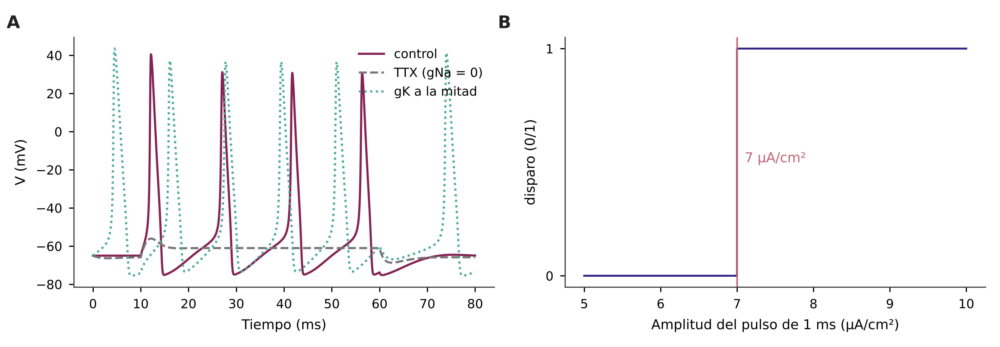
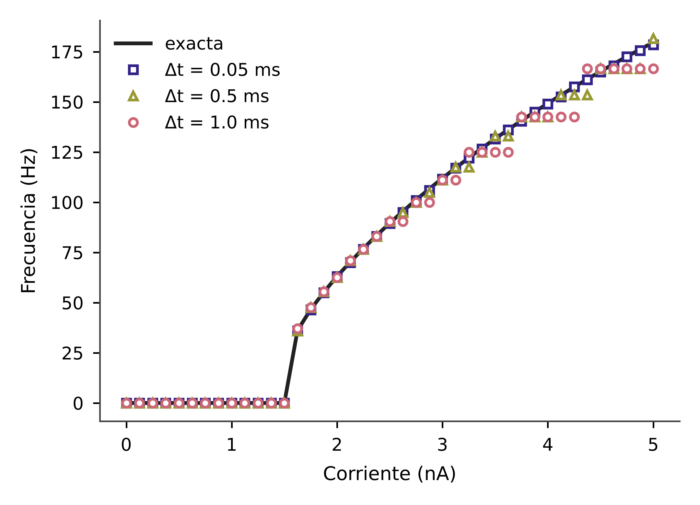
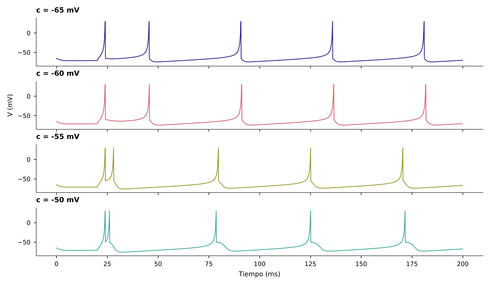
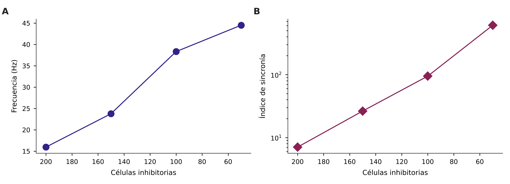
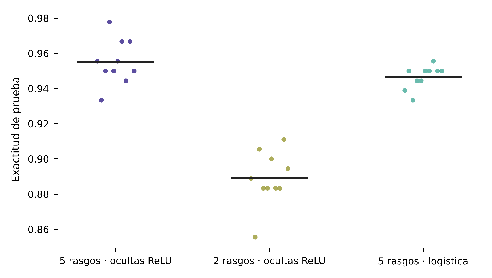
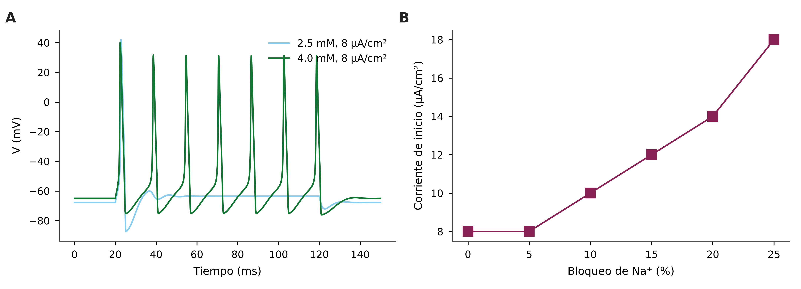
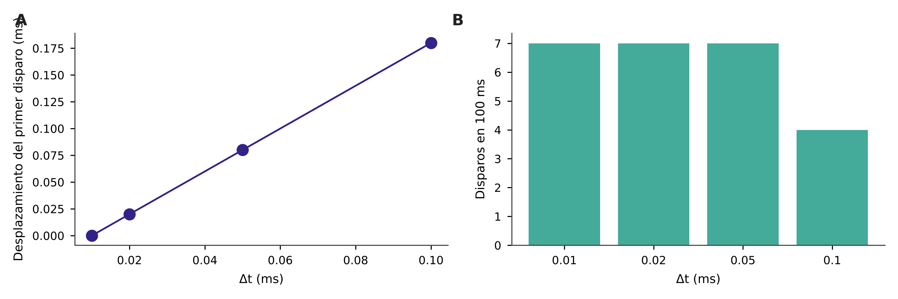

# Cómo usar este cuaderno

Este cuaderno acompaña al artículo y a los siete cuadernos Jupyter. En cada módulo encontrarás (1) el objetivo, (2) las pocas líneas de código que necesitas, (3) qué cambiar y (4) el resultado esperado, con una figura para comparar con tu propia salida. Todas las figuras se generaron con `make_supplement_figures.py --lang es`, así que tus números deberían coincidir exactamente si usas las mismas semillas.

**Preparación (una sola vez).**

```bash
pip install -r requirements.txt     # numpy, matplotlib, jupyter
jupyter notebook notebooks_es/      # cuadernos en español
```

Todos los fragmentos suponen:

```python
import numpy as np, matplotlib.pyplot as plt
import neurosim as ns
```

**Método de trabajo para cada ejercicio.** Antes de ejecutar un cambio, escribe tu predicción en una oración. Ejecútalo. Compara. Si el resultado te sorprendió, busca la línea de código responsable. Ese ciclo de predecir, observar y explicar es el objetivo de los ejercicios.

---

# Módulo 1 · Hodgkin-Huxley: de dónde sale el potencial de acción

**Objetivo.** Identificar el papel de las corrientes de Na⁺ y K⁺ y medir un umbral de excitabilidad.

```python
pulso = lambda t: 10.0 if 10 <= t < 60 else 0.0
control = ns.simulate_hh(pulso, 80)
ttx     = ns.simulate_hh(pulso, 80, params={"gNa": 0.0})   # todos los canales de Na+ bloqueados
mitad_k = ns.simulate_hh(pulso, 80, params={"gK": 18.0})   # conductancia de K+ a la mitad
```

**Qué cambiar.** (a) Bloquea por completo los canales de sodio. (b) Reduce a la mitad la conductancia de potasio. (c) Encuentra el pulso de 1 ms más pequeño que produce un disparo:

```python
for amp in np.arange(5, 10.01, 0.25):
    r = ns.simulate_hh(lambda t, a=amp: a if 5 <= t < 6 else 0.0, 30)
    print(amp, ns.spike_times(r["t"], r["V"]).size)
```

**Resultado esperado (Fig. S1).** Sin corriente de sodio no hay potencial de acción, solo una pequeña despolarización pasiva. Con la mitad de la conductancia de potasio, los disparos son más anchos y la célula dispara más rápido. Un pulso de 1 ms necesita 7,0 µA/cm² para producir un disparo (malla de 0,25 µA/cm²). No lo confunda con el inicio del disparo repetitivo ante un escalón largo, de unos 6,3 µA/cm² (artículo, Fig. 2D): un pulso breve debe entregar su carga en 1 ms.



**Figura S1.** (A) Respuesta al mismo pulso en el control, con bloqueo total de Na⁺ (TTX) y con la mitad de la conductancia de K⁺. (B) Disparo (1) o ausencia de disparo (0) según la amplitud de un pulso de 1 ms; la línea vertical marca el umbral.

**Para discutir.** ¿Por qué la TTX produce parálisis y adormecimiento? ¿Qué fase del potencial de acción prolongaría un bloqueador de canales de potasio?

---

# Módulo 2 · LIF: umbral, reinicio y error numérico

**Objetivo.** Comparar una simulación con una solución exacta y ver cómo el paso de tiempo genera error.

```python
I = np.linspace(0, 5, 41)
exacta = ns.lif_rate_closed_form(I)
for dt in (0.05, 0.5, 1.0):
    sim = [ns.simulate_lif(i, 2000, dt)["spikes"].size / 2 for i in I]
```

**Resultado esperado (Fig. S2).** Con Δt = 0,05 ms la simulación cae sobre la curva exacta. Con Δt = 0,5 o 1 ms la frecuencia simulada queda sistemáticamente por debajo, porque el voltaje sobrepasa el umbral entre pasos y cada disparo se detecta tarde.



**Figura S2.** Frecuencia de disparo de la neurona LIF: solución exacta (línea) y simulaciones con tres pasos de tiempo (símbolos).

**Para discutir.** Toda simulación publicada tiene un paso de tiempo. ¿Cómo comprobarías que era lo bastante pequeño?

---

# Módulo 3 · Izhikevich: del disparo regular a las ráfagas

**Objetivo.** Ver cómo un solo parámetro cambia el patrón de disparo.

```python
a, b, _, d = ns.IZH_CLASSES["RS"]["abcd"]
for c in (-65, -60, -55, -50):
    r = ns.izhikevich_cell(a, b, c, d, lambda t: 10.0 * (t >= 20), 200)
```

**Resultado esperado (Fig. S3).** Subir el voltaje de reinicio c de −65 a −55 mV hace que la célula dispare un doblete inicial: después de cada disparo vuelve a empezar más cerca del umbral. Un patrón completo de ráfagas intrínsecas necesita además un incremento menor tras el disparo (d = 4, los valores de IB), y las ráfagas repetidas (chattering) necesitan c = −50 y d = 2.



**Figura S3.** Célula de Izhikevich de disparo regular con el voltaje de reinicio c elevado de −65 a −50 mV.

**Para discutir.** Neuronas del mismo tipo anatómico pueden disparar de forma distinta. ¿Qué dice esto sobre clasificar células solo por su patrón de disparo?

---

# Módulo 4 · Circuitos: qué ocurre cuando se pierden interneuronas

**Objetivo.** Simular la pérdida de neuronas inhibitorias, un rasgo de algunas epilepsias.

```python
for n_inh in (200, 150, 100, 50):
    stats = [ns.network_statistics(ns.simulate_ei_network(n_inh=n_inh, g=6.0, ext_rate=7.0,
             duration=400, seed=s)) for s in range(3)]
```

**Resultado esperado (Fig. S4).** Quitar interneuronas manteniendo la fuerza de cada una aumenta la frecuencia media de 16 a 45 Hz y el índice de sincronía casi 90 veces (de 7 a 610). La red pasa del disparo irregular y asíncrono a descargas hipersíncronas.



**Figura S4.** Frecuencia media (A) e índice de sincronía (B, escala logarítmica) cuando el número de células inhibitorias baja de 200 a 50 (g = 6; media de tres semillas).

**Para discutir.** ¿Cómo se relaciona esto con el EEG de una crisis? ¿Qué familias de fármacos actúan reforzando la inhibición?

---

# Módulo 5 · La máquina que aprende: ¿ayuda la complejidad?

**Objetivo.** Medir cuánto aportan los rasgos y las capas ocultas.

```python
X, y, _ = ns.make_dataset(seed=0)
for semilla in range(10):
    tr, te = ns.stratified_split(y, 0.3, seed=semilla)
    completa = ns.SpikeClassNet(5, 5, (16, 16), seed=semilla); completa.fit(X[tr], y[tr], epochs=150, seed=semilla)
    dos      = ns.SpikeClassNet(2, 5, (16, 16), seed=semilla); dos.fit(X[tr][:, [3, 1]], y[tr], epochs=150, seed=semilla)
    logit    = ns.SpikeClassNet(5, 5, (),       seed=semilla); logit.fit(X[tr], y[tr], epochs=150, seed=semilla)
```

**Resultado esperado (Fig. S5).** Con cinco rasgos la red alcanza 95,5 % (IC 95 %: 93,4–97,6, corregido por el solapamiento entre particiones) y la regresión logística 94,7 % (93,6–95,7). Con solo dos rasgos la exactitud baja a 88,9 % (86,3–91,4). Los buenos rasgos importan más que un modelo complejo. Calcule también un intervalo ingenuo (media ± 1,96·DE/√10): es unas tres veces más estrecho, porque ignora que las particiones comparten la mayoría de sus células. Use `ns.corrected_resampled_t(exactitudes, n_train=420, n_test=180)`.



**Figura S5.** Exactitud de prueba en diez particiones (puntos) y media (barra) para la red con cinco rasgos, la red con dos rasgos y la regresión logística con cinco rasgos.

**Para discutir.** Te ofrecen una herramienta de IA que lee EEG con "98 % de exactitud". ¿Qué tres preguntas de este ejercicio harías antes de confiar en ella?

---

# Módulo 6 · Escenarios clínicos: hipopotasemia y margen de seguridad del bloqueo de sodio

**Objetivo.** Ampliar los escenarios del artículo.

```python
for K in (2.5, 4.0):                                  # hipopotasemia frente a normal
    p = ns.extracellular_potassium(K)
    r = ns.simulate_hh(lambda t: 8.0 if 20 <= t < 120 else 0.0, 150, params=p, init=ns.settle(p))

I = np.arange(0, 30.1, 2.0)
for bloqueo in np.linspace(0, 0.3, 7):                # dosis-respuesta del bloqueo de Na+
    fi = ns.fi_curve(I, ns.sodium_block(bloqueo), duration=300)
```

**Resultado esperado (Fig. S6).** Con 2,5 mM de potasio extracelular la membrana se hiperpolariza y el mismo estímulo que produce disparo repetitivo con 4 mM genera un solo disparo: la excitabilidad baja, lo que concuerda con la debilidad de la hipopotasemia. La corriente necesaria para el disparo repetitivo sube con fuerza con el bloqueo de sodio (de 8 a 18 µA/cm² entre 0 y 25 % de bloqueo), y con 30 % ninguna corriente de hasta 30 µA/cm² sostiene el disparo.



**Figura S6.** (A) Respuesta a un escalón de 8 µA/cm² con 2,5 y 4 mM de potasio extracelular. (B) Corriente necesaria para el disparo repetitivo según el bloqueo de canales de sodio (resolución de 2 µA/cm²).

**Para discutir.** ¿Por qué tanto la hipopotasemia como la hiperpotasemia grave producen debilidad, mediante cambios opuestos del potencial de membrana?

---

# Módulo 7 · Elegir un modelo: ¿cuándo arruina el paso de tiempo la simulación?

**Objetivo.** Medir el equilibrio entre exactitud y costo en el modelo de Hodgkin-Huxley.

```python
ref = ns.simulate_hh(10.0, 100, 0.01)
for dt in (0.02, 0.05, 0.1):
    r = ns.simulate_hh(10.0, 100, dt)
```

**Resultado esperado (Fig. S7).** Hasta Δt = 0,05 ms el primer disparo se desplaza menos de 0,1 ms y el número de disparos en 100 ms no cambia (7). Con Δt = 0,1 ms el primer disparo llega 0,18 ms tarde y, tras 4 disparos, las variables de compuerta salen del intervalo 0–1 y la simulación diverge (NumPy avisa de valores no válidos): es rápida pero errónea.



**Figura S7.** Efecto del paso de tiempo en la simulación de Hodgkin-Huxley: desplazamiento del primer disparo respecto a Δt = 0,01 ms (A) y número de disparos en 100 ms (B).

**Para discutir.** Escribe un párrafo eligiendo un modelo para (a) un nuevo antiepiléptico que bloquea canales de sodio, (b) la memoria de trabajo en 10⁵ neuronas y (c) la detección automática de puntas en el EEG.

---

# Clave de respuestas para docentes (resumen)

| Ejercicio | Respuesta clave |
|---|---|
| M1 TTX | Sin I_Na no hay fase de subida; solo despolarización pasiva. |
| M1 mitad de gK | Repolarización más lenta, disparos más anchos y mayor frecuencia. |
| M1 pulso breve | 7,0 µA/cm² durante 1 ms. |
| M1 tipo II | El disparo empieza mediante una bifurcación de Hopf subcrítica: arranca con una frecuencia finita (≈50 Hz). |
| M2 Δt grande | La detección tardía del umbral subestima la frecuencia (error de 13 Hz con 1 ms). |
| M2 reobase | En estado estacionario V = E_L + R_m I ≥ V_th, así que I_rh = (V_th − E_L)/R_m = 1,5 nA. |
| M3 ráfagas | Con c ≥ −55 mV aparece un doblete inicial; IB necesita d = 4 y CH necesita c = −50, d = 2. |
| M4 pérdida de interneuronas | Frecuencia de 16 a 45 Hz y sincronía de 7 a 610 cuando las células inhibitorias bajan de 200 a 50. |
| M5 complejidad | Regresión logística ≈ red (el IC corregido de la diferencia incluye 0; en 600 células nuevas, McNemar p = 0,44); con dos rasgos se pierden ≈7 puntos. |
| M5 sobreajuste | La pérdida de prueba sube mientras la de entrenamiento baja; usar parada temprana, regularización o más datos. |
| M6 hipopotasemia | Hiperpolarización y menor excitabilidad. |
| M6 hiperpotasemia | Disparo espontáneo entre 6 y 8 mM; bloqueo por despolarización por encima de 8,5 mM (inactivación de h). |
| M7 Δt | Correcto hasta 0,05 ms; con 0,1 ms el método de Euler se vuelve inestable tras 4 disparos. |

Todos los números provienen de `results/results.json` y `results/supplement_results.json`.

# Glosario bilingüe

| Inglés | Español |
|---|---|
| action potential, spike | potencial de acción, disparo |
| gating variable | variable de compuerta |
| leaky integrate-and-fire (LIF) | integración y disparo con fuga |
| threshold, reset, refractory period | umbral, reinicio, período refractario |
| rheobase | reobase |
| firing rate, f-I curve | frecuencia de disparo, curva frecuencia-corriente |
| bursting, adaptation | disparo en ráfagas, adaptación |
| excitatory / inhibitory | excitatorio / inhibitorio |
| inter-spike interval (ISI), CV | intervalo entre disparos, coeficiente de variación |
| weight, bias, activation function | peso, sesgo, función de activación |
| loss, backpropagation, gradient descent | pérdida, retropropagación, descenso de gradiente |
| overfitting, baseline | sobreajuste, modelo de referencia |
| time step, forward Euler | paso de tiempo, método de Euler explícito |
| depolarisation block | bloqueo por despolarización |
