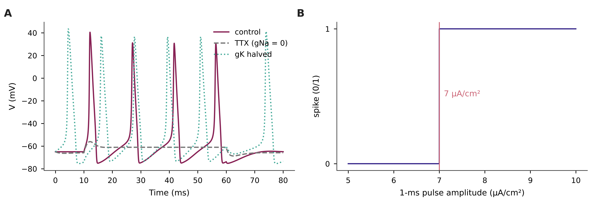
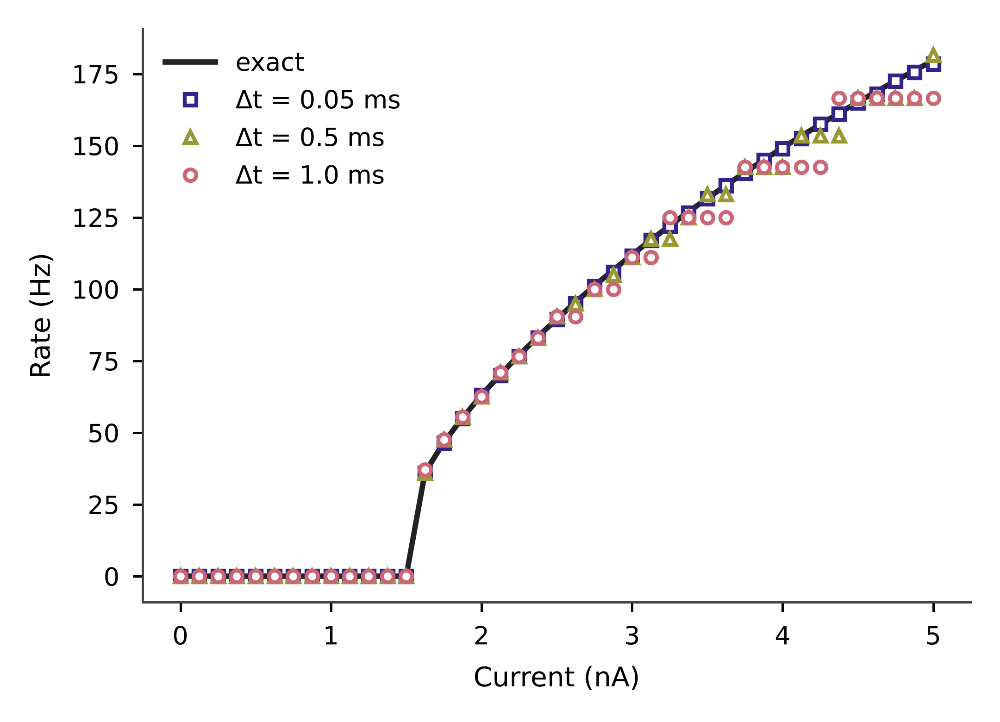
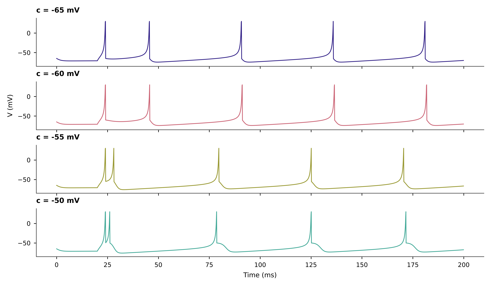
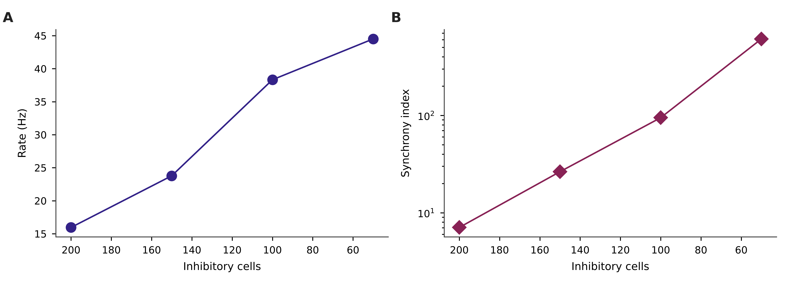
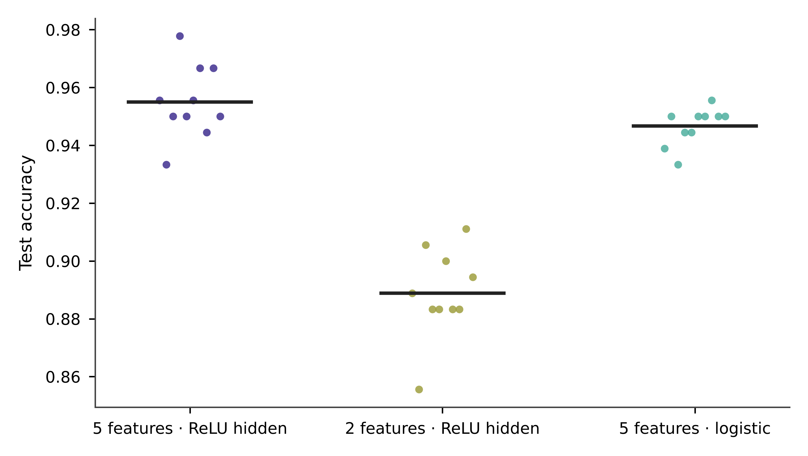
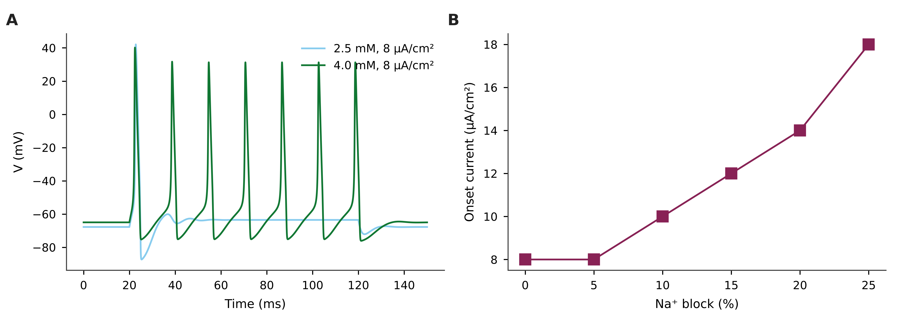
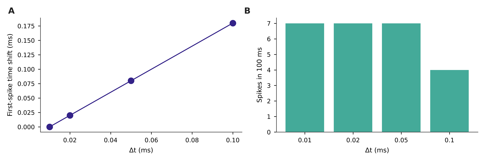

# How to use this workbook

This workbook accompanies the article and the seven Jupyter notebooks. For each module it gives (1) the goal, (2) the few lines of code you need, (3) what to change, and (4) the expected result, with a figure you can compare against your own output. Every figure here was produced by `make_supplement_figures.py`, so your numbers should match exactly if you use the same seeds.

**Setup (once).**

```bash
pip install -r requirements.txt     # numpy, matplotlib, jupyter
jupyter notebook notebooks/         # English   ·   notebooks_es/ for Spanish
```

Every snippet below assumes:

```python
import numpy as np, matplotlib.pyplot as plt
import neurosim as ns
```

**A working method for every exercise.** Before running a change, write down your prediction in one sentence. Run it. Compare. If the result surprised you, find the line of code responsible. This predict-observe-explain cycle is the point of the exercises.

---

# Module 1 · Hodgkin-Huxley: where the spike comes from

**Goal.** Identify the roles of Na⁺ and K⁺ currents and measure an excitability threshold.

```python
pulse = lambda t: 10.0 if 10 <= t < 60 else 0.0
control = ns.simulate_hh(pulse, 80)
ttx     = ns.simulate_hh(pulse, 80, params={"gNa": 0.0})   # all Na+ channels blocked
half_k  = ns.simulate_hh(pulse, 80, params={"gK": 18.0})   # K+ conductance halved
```

**What to change.** (a) Block sodium channels completely. (b) Halve potassium conductance. (c) Find the smallest 1 ms pulse that evokes a spike:

```python
for amp in np.arange(5, 10.01, 0.25):
    r = ns.simulate_hh(lambda t, a=amp: a if 5 <= t < 6 else 0.0, 30)
    print(amp, ns.spike_times(r["t"], r["V"]).size)
```

**Expected result (Fig. S1).** Without sodium current there is no action potential, only a small passive depolarisation. With half the potassium conductance, spikes are broader and the cell fires faster. A 1 ms pulse needs 7.0 µA/cm² to fire the cell (0.25 µA/cm² grid). Do not confuse this with the onset of repetitive firing for a long step, about 6.3 µA/cm² (article, Fig. 2D): a brief pulse must deliver its charge in 1 ms.



**Figure S1.** (A) Response to the same pulse in control, after complete Na⁺ block (TTX) and with half the K⁺ conductance. (B) Spike (1) or no spike (0) as a function of the amplitude of a 1 ms pulse; the vertical line marks the threshold.

**Discuss.** Why does TTX cause paralysis and numbness? Which phase of the action potential would a potassium-channel blocker prolong?

---

# Module 2 · LIF: threshold, reset and numerical error

**Goal.** Compare a simulation with an exact solution and see how the time step creates error.

```python
I = np.linspace(0, 5, 41)
exact = ns.lif_rate_closed_form(I)
for dt in (0.05, 0.5, 1.0):
    sim = [ns.simulate_lif(i, 2000, dt)["spikes"].size / 2 for i in I]
```

**Expected result (Fig. S2).** At Δt = 0.05 ms the simulation lies on the exact curve. With Δt = 0.5 or 1 ms the simulated rate is systematically too low, because the voltage overshoots the threshold between steps and each spike is detected late.



**Figure S2.** Firing rate of the LIF neuron: exact solution (line) and simulations with three time steps (symbols).

**Discuss.** Every simulation you read in a paper has a time step. How would you check that it was small enough?

---

# Module 3 · Izhikevich: from regular spiking to bursting

**Goal.** See how a single parameter changes the firing pattern.

```python
a, b, _, d = ns.IZH_CLASSES["RS"]["abcd"]
for c in (-65, -60, -55, -50):
    r = ns.izhikevich_cell(a, b, c, d, lambda t: 10.0 * (t >= 20), 200)
```

**Expected result (Fig. S3).** Raising the reset voltage c from −65 to −55 mV makes the cell fire an initial doublet: after each spike it restarts closer to threshold. A full intrinsically bursting pattern also needs a smaller after-spike increment (d = 4, the IB values), and repeated bursts (chattering) need c = −50 and d = 2.



**Figure S3.** A regular-spiking Izhikevich cell with the reset voltage c raised from −65 to −50 mV.

**Discuss.** Real neurons of the same anatomical type can fire differently. What does this say about classifying cells by firing pattern alone?

---

# Module 4 · Circuits: what happens when interneurons are lost

**Goal.** Simulate a loss of inhibitory neurons, a feature of some epilepsies.

```python
for n_inh in (200, 150, 100, 50):
    stats = [ns.network_statistics(ns.simulate_ei_network(n_inh=n_inh, g=6.0, ext_rate=7.0,
             duration=400, seed=s)) for s in range(3)]
```

**Expected result (Fig. S4).** Removing interneurons while keeping their individual strength increases the mean rate from 16 to 45 Hz and the synchrony index almost 90-fold (from 7 to 610). The network moves from irregular, asynchronous firing to hypersynchronous volleys.



**Figure S4.** Mean firing rate (A) and synchrony index (B, log scale) as the number of inhibitory cells falls from 200 to 50 (g = 6; mean of three seeds).

**Discuss.** How does this relate to the EEG of a seizure? Which drug classes act by enhancing inhibition?

---

# Module 5 · The learning machine: does complexity help?

**Goal.** Test how much the features and the hidden layers contribute.

```python
X, y, _ = ns.make_dataset(seed=0)
for seed in range(10):
    tr, te = ns.stratified_split(y, 0.3, seed=seed)
    full  = ns.SpikeClassNet(5, 5, (16, 16), seed=seed); full.fit(X[tr], y[tr], epochs=150, seed=seed)
    two   = ns.SpikeClassNet(2, 5, (16, 16), seed=seed); two.fit(X[tr][:, [3, 1]], y[tr], epochs=150, seed=seed)
    logit = ns.SpikeClassNet(5, 5, (),       seed=seed); logit.fit(X[tr], y[tr], epochs=150, seed=seed)
    # store the test accuracy of each model, e.g. np.mean(full.predict(X[te]) == y[te])

# the ten splits overlap, so use the corrected interval, not a naive one:
ns.corrected_resampled_t(accuracies, n_train=420, n_test=180)
```

**Expected result (Fig. S5).** With five features the network reaches 95.5% (95% CI 93.4–97.6, corrected for overlap between splits) and logistic regression 94.7% (93.6–95.7). With only two features accuracy falls to 88.9% (86.3–91.4). Good features matter more than a complex model. Try computing a naive interval (mean ± 1.96·SD/√10) as well: it is about three times narrower, because it ignores that the splits share most of their cells.



**Figure S5.** Test accuracy over ten splits (dots) and mean (bar) for the five-feature network, the two-feature network and five-feature logistic regression.

**Discuss.** You are offered an AI tool that reads EEGs with "98 % accuracy". Which three questions from this exercise would you ask before trusting it?

---

# Module 6 · Clinical scenarios: hypokalaemia and the safety margin of sodium block

**Goal.** Extend the scenarios in the article.

```python
for K in (2.5, 4.0):                                  # hypokalaemia vs normal
    p = ns.extracellular_potassium(K)
    r = ns.simulate_hh(lambda t: 8.0 if 20 <= t < 120 else 0.0, 150, params=p, init=ns.settle(p))

I = np.arange(0, 30.1, 2.0)
for block in np.linspace(0, 0.3, 7):                  # dose-response of Na+ block
    fi = ns.fi_curve(I, ns.sodium_block(block), duration=300)
```

**Expected result (Fig. S6).** At 2.5 mM extracellular potassium the membrane hyperpolarises and the same stimulus that drives repetitive firing at 4 mM produces a single spike: excitability falls, consistent with the weakness of hypokalaemia. The current needed for repetitive firing rises steeply with sodium block (from 8 to 18 µA/cm² between 0 and 25 % block), and at 30 % no current up to 30 µA/cm² sustains firing.



**Figure S6.** (A) Response to an 8 µA/cm² step at 2.5 and 4 mM extracellular potassium. (B) Current needed for repetitive firing as a function of sodium-channel block (2 µA/cm² resolution).

**Discuss.** Why do both hypokalaemia and severe hyperkalaemia cause weakness, through opposite changes in membrane potential?

---

# Module 7 · Choosing a model: when does the time step break the simulation?

**Goal.** Measure the accuracy-cost trade-off of the Hodgkin-Huxley model.

```python
ref = ns.simulate_hh(10.0, 100, 0.01)
for dt in (0.02, 0.05, 0.1):
    r = ns.simulate_hh(10.0, 100, dt)
```

**Expected result (Fig. S7).** Up to Δt = 0.05 ms the first spike shifts by less than 0.1 ms and the number of spikes in 100 ms is unchanged (7). At Δt = 0.1 ms the first spike is 0.18 ms late and, after 4 spikes, the gating variables leave the range 0–1 and the simulation blows up (NumPy warns about invalid values): it is fast but wrong.



**Figure S7.** Effect of the time step on the Hodgkin-Huxley simulation: shift of the first spike relative to Δt = 0.01 ms (A) and number of spikes in 100 ms (B).

**Discuss.** Write one paragraph choosing a model for (a) a new sodium-channel antiseizure drug, (b) working memory in 10⁵ neurons, (c) automatic EEG spike detection.

---

# Answer key for instructors (short)

| Exercise | Key answer |
|---|---|
| M1 TTX | No upstroke without I_Na; only passive depolarisation. |
| M1 half gK | Slower repolarisation, broader spikes, higher rate. |
| M1 brief pulse | 7.0 µA/cm² for 1 ms. |
| M1 type II | Onset through a subcritical Hopf bifurcation: firing starts at a finite rate (≈50 Hz). |
| M2 large Δt | Late threshold detection under-estimates the rate (13 Hz error at 1 ms). |
| M2 rheobase | Steady state V = E_L + R_m I ≥ V_th gives I_rh = (V_th − E_L)/R_m = 1.5 nA. |
| M3 bursting | c ≥ −55 mV gives an initial doublet; IB needs d = 4, CH needs c = −50, d = 2. |
| M4 interneuron loss | Rate 16 → 45 Hz; synchrony 7 → 610 as inhibitory cells fall from 200 to 50. |
| M5 complexity | Logistic regression ≈ network (corrected CI of the difference includes 0; on 600 new cells McNemar p = .44); two features lose ≈7 points. |
| M5 overfitting | Test loss rises while training loss falls; use early stopping, regularisation or more data. |
| M6 hypokalaemia | Hyperpolarisation and reduced excitability. |
| M6 hyperkalaemia | Spontaneous firing at 6–8 mM, depolarisation block above 8.5 mM (h inactivation). |
| M7 Δt | Correct up to 0.05 ms; at 0.1 ms the Euler scheme becomes unstable after 4 spikes. |

All numbers come from `results/results.json` and `results/supplement_results.json`.
