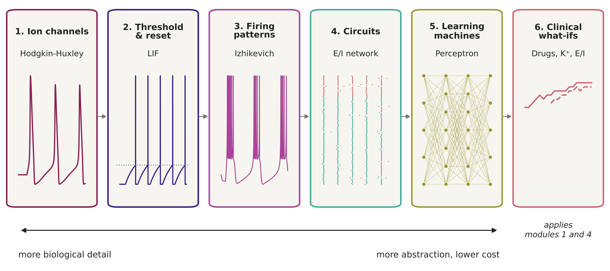
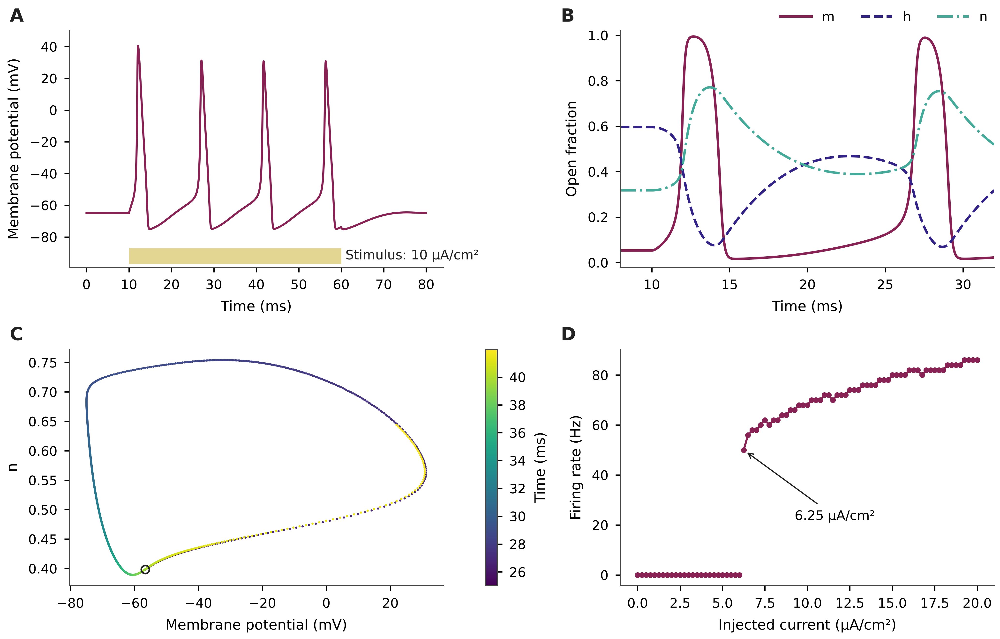
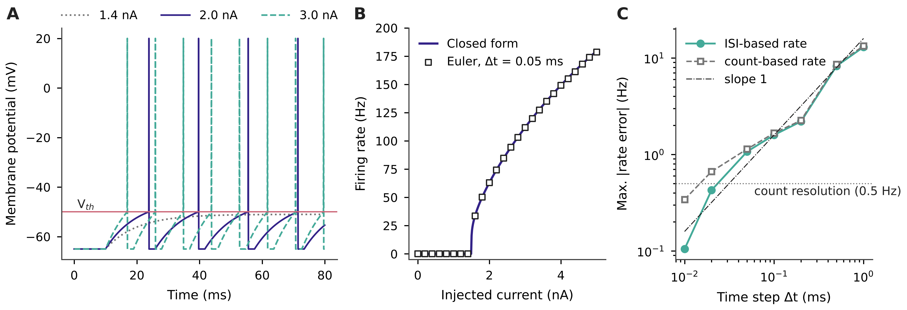
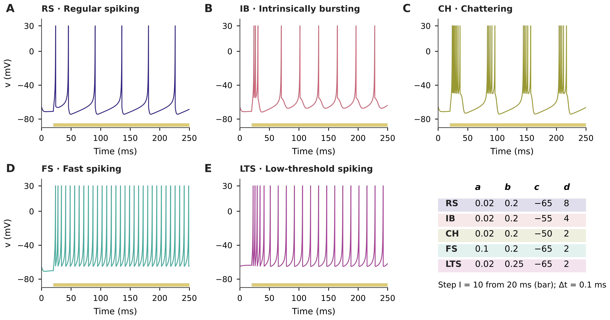
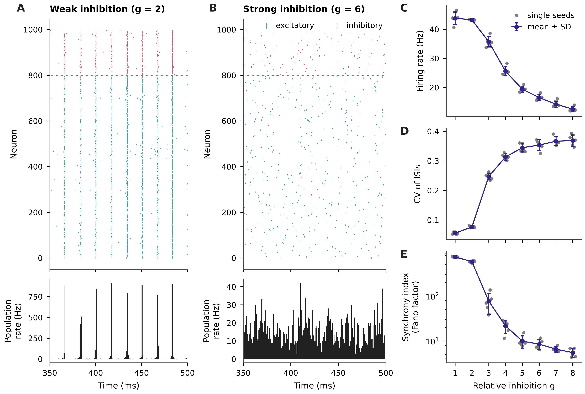
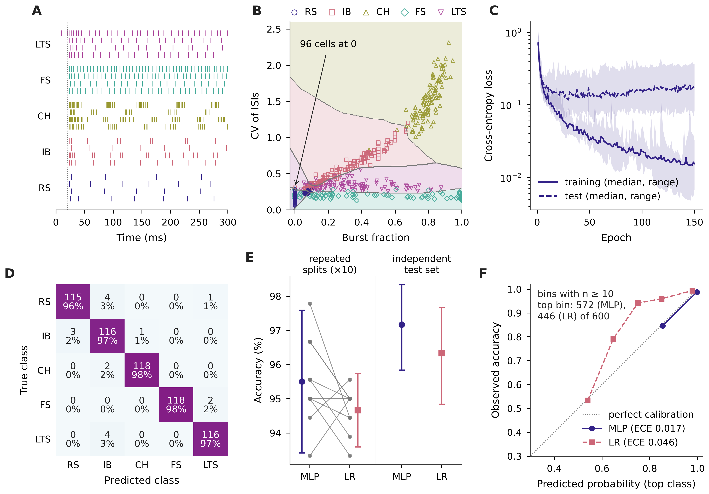
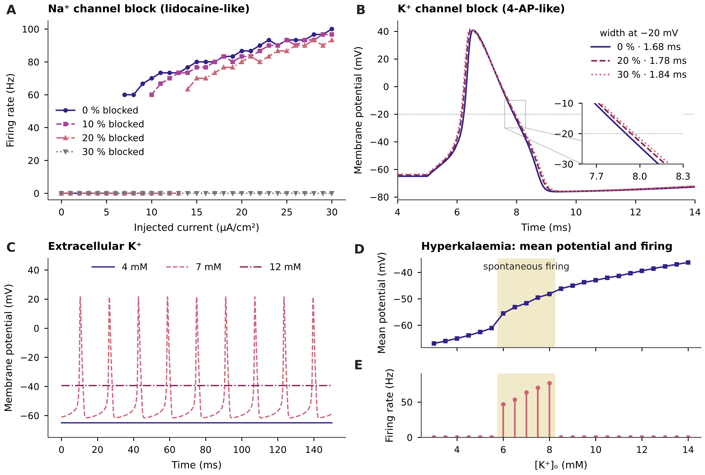

# Abstract

**Background.** Physicians and life-science students rarely learn to run or question computational neuron models. Most teaching material is English-only, hides the numerical core in specialised simulators, and separates biophysical models from the artificial neural networks of clinical machine learning.

**Methods.** NeuroSim-Edu is an open-source resource needing only Python, NumPy and Matplotlib. Seven modules cover Hodgkin-Huxley, leaky integrate-and-fire (LIF) and Izhikevich neurons, a 1,000-cell excitatory-inhibitory network, a perceptron that classifies simulated spike trains, clinical "what-if" experiments and a realism-cost comparison. Each simulator is a short Euler loop readable beside its equation. English and Spanish notebooks share one source; a single-file browser simulator runs offline without installation. Models were checked against analytical or published benchmarks; the classifier was tested on 600 new simulated cells.

**Results.** Each model reproduced its reference behaviour: abrupt (type II) Hodgkin-Huxley firing onset near 6.3 µA/cm²; LIF rates within 1.1 Hz of the closed-form solution, with first-order convergence; five cortical firing patterns from four Izhikevich parameters; and network synchrony falling as inhibition increased (synchrony index 736 to 5.5). The perceptron identified five neuron classes with 97.2% accuracy (95% CI 95.8–98.3), not distinguishable from logistic regression (96.3%; McNemar p = .44). Clinical scenarios qualitatively reproduced sodium- and potassium-channel block and hyperkalaemic depolarisation block. Hodgkin-Huxley simulations were roughly 100 and 600–800 times slower than LIF and Izhikevich simulations.

**Conclusions.** NeuroSim-Edu offers a transparent, reproducible, bilingual route from membrane biophysics to machine learning, linked to pharmacology, electrolyte disorders, epilepsy and appraisal of clinical artificial intelligence. Learning effects are untested; a pilot study is planned.

**Keywords:** computational biology; neurosciences/education; education, medical; neurons; models, neurological; action potentials; machine learning; neural networks, computer; open educational resources; Spanish

# 1. Introduction

Mathematical models of neurons are among the oldest and most successful tools in physiology. Hodgkin and Huxley's quantitative description of the squid giant axon [1] explained the action potential through voltage-dependent sodium and potassium conductances, and it remains the template for conductance-based models of cardiac, muscle and neuronal excitability [2–5]. Cable theory and compartmental modelling extended the same framework from a membrane patch to neurons with branched dendrites and axons [6,7]. Simpler point-neuron models, from Lapicque's integrate-and-fire neuron [8,9] to the two-variable model of Izhikevich [10,11], made phase-plane analysis of excitability possible [12–15] and allowed networks of thousands to millions of cells to be simulated [16,17]. A separate line of abstraction began with McCulloch and Pitts [18] and the perceptron [19], led through backpropagation [20] to modern deep learning [21], and now underlies clinical decision-support systems in neurology, radiology and electrophysiology [22,23].

Physicians use these ideas routinely, often without recognising them. The actions of sodium-channel blockers such as lidocaine, phenytoin and carbamazepine are explained by the gating of voltage-dependent channels [24–28]. The neurological and cardiac effects of hyperkalaemia can be understood largely through the Nernst equation and sodium-channel inactivation [29,30]. The view that seizures arise when the balance between excitation and inhibition fails rests partly on network models [31–34], and many of the machine-learning tools that read EEG or classify cells are artificial neural networks [21,23]. Yet physiology is hard to learn, largely because it demands causal reasoning with graphs and mathematics [35], and medical students often regard neurology as one of the most difficult disciplines, a phenomenon termed neurophobia [36]. Letting learners change a parameter and see its consequence is one way to make that causal reasoning concrete.

Good resources exist, but most were built for other audiences. Textbooks provide the theory [2,3,37]; mature simulators such as NEURON [7], NEST [38] and Brian 2 [39] support research-grade simulation; and Neuromatch Academy has taught computational neuroscience online to more than 1,700 students worldwide [40]. Smaller teaching simulators, from early web-based Hodgkin-Huxley laboratories for first-year medical students to MetaNeuron and SNNAP-based virtual laboratories, show that hands-on exploration of excitability is feasible in the classroom [41–43]. More recent tools simulate networks of spiking neurons graphically on phones, computers or in the browser (Neuronify and NEST Desktop) [44,45], expose conductance-based models through code for research and teaching (Xolotl) [46], simulate ion channels in a web app (Panama) [47] or support electrophysiology practicals (Neurosim and LabAXON, the latter for medical students) [48,49], and a colour-coded graphical guide now makes the original Hodgkin-Huxley papers accessible to students [50]. For clinicians and life-science students, three gaps remain. First, research simulators hide the numerical loop and most teaching simulators expose parameters only through graphical interfaces, so learners rarely see that a neuron model is a few lines of arithmetic repeated over time. Second, biophysical models and artificial neural networks are taught by different communities, in different courses and with different notation, so students who later meet a clinical AI tool seldom connect it with the neuron models they learned in physiology; to our knowledge, none of the teaching tools above links the two (Section 5.6). Third, nearly all of this material is in English [51,52]. A PubMed search (November 2026) for Spanish-language or Latin American teaching resources in computational neuroscience found no peer-reviewed, openly licensed teaching module, and we found none that addresses all three gaps for a clinical audience.

Here we present NeuroSim-Edu, an open, bilingual teaching resource designed to close these gaps. It rests on three principles. The first is transparency: every model is a short, explicit NumPy loop that maps line by line onto its equation. The second is continuity: a single pathway leads from ion channels to circuits, then to a learning machine trained on the outputs of the biophysical models, and back to clinical questions. The third is accessibility: English and Spanish notebooks and figures are generated from one source, the only dependencies are NumPy and Matplotlib, a browser version runs without any installation, and a guide written for physicians accompanies the modules. We describe the resource, verify each model quantitatively, and discuss how it can be used in teaching, clinical education and research training.

# 2. Methods

## 2.1 Design and intended audience

NeuroSim-Edu was designed for three groups: (a) medical students and residents in neurology, psychiatry, anaesthesiology and physiology; (b) undergraduate and graduate students in neuroscience, biology, psychology and biomedical engineering; and (c) clinicians and researchers who want a first, hands-on introduction to modelling. No programming experience is assumed beyond running a cell in a Jupyter notebook [53]. Learning objectives were written before the code, following constructive alignment [54]. Each module ends with exercises that ask learners to change a parameter, predict the outcome and explain the result, an approach consistent with evidence on active learning and simulation in science and medical education [55–58].

## 2.2 Software architecture

The `neurosim` package (685 lines including documentation) contains five modules: `hh` (Hodgkin-Huxley), `point` (LIF and Izhikevich), `network` (excitatory-inhibitory network), `classifier` (data generation, features, neural network and evaluation statistics) and `clinic` (clinical scenarios). It depends only on NumPy [59] and the Python standard library; figures are drawn with Matplotlib [60]. Every simulator uses forward Euler integration with an explicit time step, so each line of the loop corresponds to one term of the governing equation. Seven Jupyter notebooks (Table 1) import the package, display the source code of the function under study with Python's `inspect` module, run it, plot the result and end with three to five exercises. A script, `build_notebooks.py`, writes the English and Spanish notebooks from a single source file, which guarantees identical code in both languages. A second script, `make_figures.py`, regenerates every figure and number in this article and writes them, together with the software versions and hardware, to a machine-readable results file. All random processes use fixed seeds, listed in Supplementary Table S2.1. The repository follows published recommendations for reproducible computational research and for writing and sharing analyses in Jupyter notebooks [61,62]. The analyses reported here were run with Python 3.13, NumPy 2.5 and Matplotlib 3.11 on a 2.1 GHz Intel Xeon processor (4 logical CPUs, Linux).

**Table 1.** Structure of the teaching pathway.

| Module | Model (state variables; Δt) | Core concepts | Built-in quantitative check | Clinical link | Figure | Estimated time* |
|---|---|---|---|---|---|---|
| 1 | Hodgkin-Huxley patch (V, m, h, n; 0.01 ms) | ionic currents, gating, type II excitability | onset of the f-I curve; time-step sensitivity | Na⁺ and K⁺ channel pharmacology | 2 | 60 min |
| 2 | Leaky integrate-and-fire (V; 0.01–1 ms) | threshold, reset, refractoriness, numerical error | simulated vs closed-form rate; first-order convergence | rheobase, strength-duration | 3 | 45 min |
| 3 | Izhikevich (v, u; 0.1 ms) | recovery variable, bursting, adaptation | spike counts of five published classes | electrophysiological cell types | 4 | 45 min |
| 4 | E/I network, 800 E + 200 I LIF cells (0.1 ms) | E/I balance, synchrony, irregularity | rate, CV and synchrony against g, five seeds | seizures, interneuron loss | 5 | 60 min |
| 5 | Multilayer perceptron 5-16-16-5 vs logistic regression | weighted sum, nonlinearity, backpropagation, validation, calibration | repeated splits and independent test set | clinical machine learning, appraisal of AI tools | 6 | 60 min |
| 6 | Perturbations of modules 1 and 4 | parameter perturbation, Nernst equation | onset currents, spike width, [K⁺]ₒ sweep | lidocaine, 4-aminopyridine, hyper- and hypokalaemia, loss of inhibition | 7 | 60 min |
| 7 | Comparison of modules 1–3 | model selection, computational cost | time per simulated second and per step | choosing a model for a question | Table 2 | 30 min |

*Authors' estimate; not yet measured with learners.

## 2.3 Neuron and network models

**Hodgkin-Huxley.** We used the standard squid-axon parameters in the modern convention (resting potential near −65 mV): C = 1 µF/cm², ḡ_Na = 120, ḡ_K = 36, g_L = 0.3 mS/cm², E_Na = 50, E_K = −77, E_L = −54.4 mV [1,2]. The membrane equation and the three gating equations were integrated with the forward Euler method (Δt = 0.01 ms). Unless stated otherwise, simulations started with the gates at their steady-state values for V = −65 mV; perturbed cells were first run without input for 300 ms and started from the final state. Spikes were detected as upward crossings of 0 mV. Sustained firing rates were the number of spikes between 100 and 600 ms divided by 0.5 s (resolution 2 Hz), for constant currents from 0 to 20 µA/cm² in steps of 0.25 µA/cm². To check the time step, rates near the threshold were recomputed with Δt = 0.005 and 0.0025 ms.

**Leaky integrate-and-fire.** The membrane potential follows τ_m dV/dt = −(V − E_L) + R_m I, with τ_m = 10 ms, E_L = V_reset = −65 mV, V_th = −50 mV, R_m = 10 MΩ and a 2 ms absolute refractory period [3,9]. Because the subthreshold equation is linear, the firing rate for a constant current has the closed form f = [t_ref + τ_m ln(R_m I / (R_m I − (V_th − E_L)))]⁻¹. We used this expression to measure the error of the Euler method for time steps between 0.01 and 1 ms and 18 currents between 1.6 and 5 nA (2 s each) [63]. The simulated rate was computed as the inverse of the mean inter-spike interval (ISI), which, unlike a spike count, is not limited by the 0.5 Hz resolution of a 2 s simulation.

**Izhikevich.** The model is dv/dt = 0.04v² + 5v + 140 − u + I and du/dt = a(bv − u), with reset v ← c, u ← u + d when v ≥ 30 mV [10]. We used the published parameter sets for regular spiking (RS), intrinsically bursting (IB), chattering (CH), fast spiking (FS) and low-threshold spiking (LTS) cells [10,11,64], and a step current I = 10 (dimensionless) from t = 20 ms, integrated with Δt = 0.1 ms from v = −65 mV and u = bv. The package includes a scalar version for reading and a vectorised version for populations.

**Excitatory-inhibitory network.** Eight hundred excitatory and 200 inhibitory LIF cells were connected by independent Bernoulli draws with probability 0.1 (no self-connections) through current-based delta synapses: a presynaptic spike shifted the postsynaptic potential by J = 0.2 mV (excitatory) or −gJ (inhibitory) at the next time step (effective delay 0.1 ms), where g is the relative strength of inhibition; input arriving during the refractory period was discarded. Each cell also received independent Poisson input at a rate ν_ext, each event adding J. Initial potentials were drawn uniformly between reset and threshold. The design follows the sparse balanced network of Brunel [31,65], but without its transmission delay. We simulated 500 ms (Δt = 0.1 ms) for two illustrative regimes (g = 2, ν_ext = 8 kHz; g = 6, ν_ext = 7 kHz) and swept g from 1 to 8 with ν_ext = 7 kHz (400 ms; seeds 0–4, each seed changing connectivity, initial potentials and external input). We report the mean firing rate, the mean coefficient of variation (CV) of ISIs (every fifth cell with more than three spikes) and a synchrony index, defined as the Fano factor (variance/mean) of the population spike count in 1 ms bins [66]; independent Poisson firing gives a value close to 1. All measures were computed after the first 100 ms and are given as mean ± SD over seeds, with individual seeds shown.

## 2.4 From spiking neurons to a learning machine

To link biophysical models with machine learning through a task familiar to electrophysiologists, we trained a small artificial neural network to identify the class of a simulated neuron from its spike train. We generated 120 cells per class (600 in total, seed 0). For each cell, the parameters a, b and d were multiplied by (1 + 0.1·N(0,1)) and c was shifted by 2·N(0,1) mV. The cell received a step current from 20 ms with an amplitude drawn uniformly between 6 and 14, plus a white-noise current with diffusion coefficient σ = 2 (Euler-Maruyama scheme, per-step SD σ/√Δt), and was simulated for 500 ms with Δt = 0.25 ms. Five interpretable features were extracted from each spike train: log₁₀(1 + mean rate), CV of ISIs, an adaptation index (last ISI − first ISI)/(last ISI + first ISI), the fraction of ISIs shorter than 10 ms ("burst fraction") and first-spike latency after step onset (capped at 100 ms). For cells with fewer than three spikes, CV, adaptation and burst fraction were set to 0.

The classifier was a multilayer perceptron with two hidden layers of 16 rectified linear units and a softmax output (453 parameters). It was trained by mini-batch gradient descent (batch 32, learning rate 0.05, momentum 0.9, L2 penalty 10⁻⁴, 150 epochs) on features standardised on each training set, with weights initialised by the He method [67]. Hyperparameters were set before the evaluation and were not tuned on the test data. As a statistical baseline we fitted multinomial logistic regression with the same code and no hidden layer, because machine learning rarely outperforms logistic regression in clinical prediction [68].

Both models were evaluated in two ways. First, on ten repeated stratified 70/30 splits of the 600 cells (420 training, 180 test; seeds 0–9), with 95% confidence intervals from the corrected resampled t statistic, because overlapping training sets make naive intervals too narrow [69,70]. Second, because simulated data are unlimited, on an independent test set of 600 new cells (seed 1), after training each model once on all 600 development cells. On this set we report accuracy and macro-averaged F1 [71] with stratified bootstrap intervals (2,000 resamples) [72], the exact McNemar test for paired predictions [73] and calibration (Brier score and expected calibration error, ECE) [74,75]. The full statistical procedure and all results (corrected intervals, log-loss, per-class metrics and variability over initialisation seeds) are given in Supplementary File S2 (Tables S2.2 and S2.5). For visualisation only, a second network trained on two features (burst fraction and CV) of all 600 cells was used to draw decision regions.

## 2.5 Clinical scenarios

Four perturbations illustrate mechanisms that physicians meet in practice. They are explicitly qualitative, because the parameters describe the squid axon rather than human neurons. (1) Sodium-channel block, representing local anaesthetics, several antiseizure drugs and tetrodotoxin [24,25,27,28]: ḡ_Na was reduced by 0–30%, and f-I curves were computed from 0 to 30 µA/cm² in steps of 1 µA/cm² (rate from spikes between 100 and 400 ms). (2) Potassium-channel block, a simplified stand-in for 4-aminopyridine, which is used to improve walking in multiple sclerosis [76,77]: ḡ_K was reduced by 0–30%, spike width was measured at −20 mV after a 1 ms, 20 µA/cm² pulse applied to the settled cell, and spontaneous firing was measured at 30, 40 and 50% block (spikes between 100 and 600 ms, settled start). (3) Changes in extracellular potassium (hyperkalaemia and, at the low end of the range, mild hypokalaemia): E_K was shifted with the Nernst equation, E_K = −77 + 26.7 ln([K⁺]ₒ/4 mM) mV (RT/F at 37 °C, reference 4 mM), for [K⁺]ₒ between 3 and 14 mM in steps of 0.5 mM (and 2.5 mM in the practice workbook), keeping the leak reversal potential fixed; we recorded the mean potential between 200 and 400 ms and the spontaneous firing rate between 100 and 400 ms [29,30]. (4) Loss of inhibition in the network model, represented by low values of g (Section 2.3). Scenarios 1–3 used the Hodgkin-Huxley model. The browser simulator adds further qualitative scenarios that are not part of the Python analyses reported here (Section 2.7).

## 2.6 Computational cost

We timed one second of biological time for one cell of each single-neuron model (Hodgkin-Huxley Δt = 0.01 ms, LIF 0.1 ms, Izhikevich 0.25 ms) with pure-Python loops and recorded the best of five runs and the time per integration step. Absolute times depend on hardware and Python version, so we report ratios between models, pooled over several complete runs of the script.

## 2.7 Browser-based simulator

For classrooms without Python, the same models are available as an interactive browser simulator (Supplementary File S3). It is a single self-contained HTML file, with separate English and Spanish versions, that runs offline in a current Chromium-based browser (Microsoft Edge or Google Chrome) without installation, accounts or an internet connection. Its six tabs are: (1) the Hodgkin-Huxley model with clinical presets for sodium-channel block (lidocaine-like), tetrodotoxin, potassium-channel block (4-aminopyridine-like), hyperkalaemia and hypokalaemia (2.5 mM), plus two qualitative extensions that are not in the Python package: temperature, which scales all rate constants with Q₁₀ = 3 [1] and reproduces heat block of the squid axon [78], and extracellular calcium, which shifts the voltage dependence of the gates [79] to illustrate the tetany of hypocalcaemia and the hypoexcitability of hypercalcaemia; (2) the LIF neuron; (3) the Izhikevich neuron; (4) the excitatory-inhibitory network, with presets for loss of interneurons and for an antiseizure drug represented as a 2 mV rise in firing threshold; (5) Hodgkin-Huxley protocols (voltage clamp with current-voltage curves, paired-pulse refractoriness, f-I curves, spike width against potassium-channel block, and a benchmark of computational cost); and (6) an in-browser version of the spike-train classifier of Section 2.4. Each tab includes predict-observe-explain challenges, clinical cases that state the limits of the model, a glossary and a printable worksheet with a separate teacher's key. The JavaScript functions are line-by-line translations of the Python functions, and both were run on identical inputs to check agreement (Section 3.9).

## 2.8 Reproducibility and availability

All code, notebooks, figures (PNG at 600 dpi and vector PDF, in English and Spanish), the browser simulator, the results file and the scripts that regenerate them are openly available at https://github.com/VFrankl0404/neurosim-edu and archived at https://doi.org/10.5281/zenodo.24413034, under the MIT licence (code) and CC BY 4.0 (text and figures). Running `make_figures.py` reproduces every number and figure in this article in 2–4 minutes on a current laptop. No human or animal data were used, so ethical approval was not required.

# 3. Results: verification of the implementations

## 3.1 Overview of the pathway

Figure 1 summarises what the simulator lets a learner do. The pathway starts with the biophysics of a single membrane patch and removes detail step by step until only a weighted sum and a nonlinearity remain. It then returns to clinical questions by perturbing the most detailed model and the network. Each card corresponds to one notebook, and each miniature shows an experiment that the learner runs and modifies.

**Figure 1.** The NeuroSim-Edu learning pathway. Modules 1–5 move from ion channels (Hodgkin-Huxley) through threshold and reset (LIF), firing patterns (Izhikevich) and circuits (excitatory-inhibitory network) to a learning machine (perceptron). Module 6 applies modules 1 and 4 to clinical "what-if" questions; module 7 (cost comparison, Table 2) is not shown. Each miniature is an output of the corresponding notebook; axes are omitted.

## 3.2 Hodgkin-Huxley: where the spike comes from

A 50 ms current pulse of 10 µA/cm² evoked a regular train of action potentials that peaked at +40.5 mV (first spike) and about +31 mV (later spikes) and undershot to −75.1 mV (Fig. 2A). The gating variables showed the mechanism (Fig. 2B): sodium activation (m) rose first and fastest, whereas sodium inactivation (h) and potassium activation (n) followed more slowly and terminated each spike. In the V–n plane each spike traced a closed loop, which gives learners a first contact with phase-plane reasoning (Fig. 2C). The f-I curve was discontinuous: on a 0.25 µA/cm² grid the cell was silent at 6.0 µA/cm² and fired at about 50 Hz from 6.25 µA/cm² (with a finer time step, sustained firing began between 6.25 and 6.30 µA/cm²), rising to 86 Hz at 20 µA/cm² (Fig. 2D). This abrupt onset is the signature of type II excitability [4,80,81].

**Figure 2.** Hodgkin-Huxley model. (A) Membrane potential during a 10 µA/cm² pulse (bar). (B) Open fraction of the sodium activation (m), sodium inactivation (h) and potassium activation (n) gates during two spikes. (C) Trajectory of one spike in the plane of membrane potential and potassium activation; the dot marks the start. (D) Frequency-current curve (0.25 µA/cm² steps; rate from spikes between 100 and 600 ms, 2 Hz resolution, which causes the small steps). The gap marks the abrupt onset of repetitive firing.

## 3.3 Leaky integrate-and-fire: the spike as a rule, and a test of the numerical method

The LIF cell integrated its input passively until it reached threshold (Fig. 3A). A current of 1.4 nA left it just below threshold, whereas 2.0 and 3.0 nA produced regular firing. Unlike the Hodgkin-Huxley model, the f-I curve rose continuously from zero at the rheobase of 1.5 nA (type I behaviour) [80,81], and the simulated rates matched the closed-form solution within 1.07 Hz at Δt = 0.05 ms (Fig. 3B). The maximum error fell in proportion to the time step, from 13.0 Hz at 1 ms to 0.10 Hz at 0.01 ms (log-log slope 0.98; Fig. 3C), the first-order convergence expected of the Euler method [63]. Rates based on spike counts could not show errors below their 0.5 Hz resolution. Learners thus see that the error of a simulation can be measured against an exact answer, and that it shrinks at a predictable rate.

**Figure 3.** Leaky integrate-and-fire neuron. (A) Responses to three current steps starting at 10 ms; the horizontal line marks the threshold. (B) Closed-form (line) and simulated (squares; Δt = 0.05 ms, rate = 1/mean ISI) firing rate. (C) Maximum absolute error of the simulated rate over 18 currents (1.6–5 nA) against the Euler time step, for ISI-based (filled) and count-based rates (open; floor set by the 0.5 Hz resolution of a 2 s run); dash-dotted line, slope 1 (log-log axes).

## 3.4 Izhikevich: many firing patterns from four numbers

With two state variables and four parameters, the Izhikevich model produced five distinct responses to the same current step (Fig. 4): adapting regular spiking (RS, 6 spikes in 250 ms), an initial burst followed by tonic spiking (IB, 9 spikes), repetitive high-frequency bursts (CH, 22 spikes), non-adapting fast spiking typical of parvalbumin-positive interneurons (FS, 31 spikes) [64,82,83] and adapting low-threshold spiking (LTS, 20 spikes). The parameter table shows that small changes in the reset voltage (c) or the after-spike increment (d) are enough to switch between classes.

**Figure 4.** Izhikevich neuron. Responses of five cortical cell classes to the same step current (I = 10 from 20 ms, bar; Δt = 0.1 ms), with their parameters (a, b, c, d) from Izhikevich [10]. The small dip before the step arises because the simulation starts at v = −65 mV and u = bv, which is not the model's resting point.

## 3.5 Circuits: inhibition shapes collective activity

With weak inhibition (g = 2), the network fired in synchronous volleys about every 17 ms; individual cells fired almost like clocks (CV 0.06) at 58 Hz (Fig. 5A). With strong inhibition (g = 6), the population rate became nearly stationary, and cells fired at 16 Hz with much greater irregularity (CV 0.43; Fig. 5B). Across five seeds, the mean rate was similar at g = 1 and g = 2 (43.8 ± 2.1 and 43.2 ± 0.2 Hz) and then fell to 12.6 ± 0.8 Hz at g = 8 (Fig. 5C); the CV rose from 0.06 to 0.37 (Fig. 5D), and the synchrony index fell by two orders of magnitude, from 736 to 5.5 (Fig. 5E), with the steepest change between g = 2 and g = 4. Because the model has only a one-step (0.1 ms) delay and weak coupling, irregularity stayed below the CV near 1 seen in cortex [84]; Brunel's network reaches irregular firing with delta synapses and a transmission delay [31], and conductance-based synapses offer another route [85]. This gap is itself a useful point for discussion with learners.

**Figure 5.** Network of 800 excitatory (teal) and 200 inhibitory (rose) LIF neurons. (A, B) Raster of one in four cells and population rate (1 ms bins) for weak (g = 2, ν_ext = 8 kHz) and strong (g = 6, ν_ext = 7 kHz) inhibition, seed 0; note the different scales of the population-rate axes. (C–E) Mean firing rate, CV of inter-spike intervals (every fifth cell with more than three spikes) and synchrony index (Fano factor of the population count, log scale) against g (ν_ext = 7 kHz); grey dots, individual seeds; blue, mean ± SD (n = 5).

## 3.6 A learning machine that recognises neuron classes

The simulated populations produced overlapping but distinguishable spike trains (Fig. 6A). In the two-feature space of burst fraction and CV, chattering cells separated clearly, whereas RS, IB and LTS cells overlapped (Fig. 6B). Over ten repeated splits, the network reached 95.5% accuracy (95% CI 93.4–97.6, corrected for overlap between splits) and logistic regression 94.7% (93.6–95.7); the paired difference was compatible with no difference (p = .46). On 600 newly simulated cells the two models reached 97.2% (95.8–98.3) and 96.3% (94.8–97.7), a difference of 0.8 percentage points (16 versus 11 discordant cells; McNemar p = .44) (Fig. 6D, E). The network's predicted probabilities were somewhat better calibrated (ECE 0.017 vs 0.046; Fig. 6F), a difference we did not test formally. Training loss decreased steadily, while test loss reached its minimum early and then rose slightly, a visible example of mild overfitting (Fig. 6C). With well-chosen, physiologically meaningful features, a linear model performed almost as well as the neural network [68]. High accuracy is expected here, because the features were chosen to separate classes that the simulator itself defines. Full statistics, including Brier scores, log-loss, per-class metrics and variability over initialisation seeds, are given in Supplementary Tables S2.2 and S2.5.

**Figure 6.** A multilayer perceptron identifies neuron classes from simulated spike trains. (A) Spike trains of four cells per class; dotted line, step onset. (B) All 600 development cells in the plane of burst fraction and CV of ISIs, with the decision regions of a two-feature network trained on all cells (illustration); 96 cells, mostly RS, have a burst fraction of 0. (C) Training (solid) and test (dashed) loss over 150 epochs: median and range over ten splits. (D) Confusion matrix of the five-feature network on an independent test set of 600 new cells (counts and row percentages). (E) Accuracy of the network (MLP) and logistic regression (LR): grey lines, the ten splits (paired); symbols, mean with 95% CI corrected for overlapping splits; right, independent test set with 95% bootstrap CI over cells. (F) Reliability diagram on the independent test set (bins with at least 10 cells) with expected calibration error (ECE).

## 3.7 Clinical scenarios

Sodium-channel block raised the current needed for repetitive firing from 7 µA/cm² (no block; 1 µA/cm² grid, compared with 6.25 µA/cm² on the finer grid of Fig. 2D) to 10 µA/cm² (10% block) and 14 µA/cm² (20% block), and at 30% block no repetitive firing occurred up to 30 µA/cm² (Fig. 7A). This qualitatively reproduces the dose-dependent loss of excitability caused by local anaesthetics and sodium-channel-blocking antiseizure drugs. Potassium-channel block broadened the action potential from 1.68 ms to 1.78 ms (20%) and 1.84 ms (30%) (Fig. 7B); the cell remained silent at 30% block but fired spontaneously at 44 Hz with 40% and 52 Hz with 50% block, which illustrates how reducing potassium current increases excitability. Clinically, 4-aminopyridine can provoke seizures, especially at high doses or in overdose [77,86]. Lowering extracellular potassium to 3 mM, the low end of the sweep, shifted E_K from −77 to −84.7 mV but hyperpolarised the membrane by only 1.9 mV (mean potential −66.9 mV, against −65.0 mV at 4 mM), because the leak reversal potential was held fixed; the cell remained silent (Fig. 7D, E). In the practice workbook (Supplementary File S1, Module 6, Fig. S6), 2.5 mM potassium hyperpolarised the membrane to about −68 mV, and an 8 µA/cm² step that evoked seven spikes at 4 mM evoked a single spike: excitability fell. Raising extracellular potassium depolarised the membrane progressively (Fig. 7C, D). The cell remained silent up to 5.5 mM, fired spontaneously between 6 and 8 mM (47–77 Hz; Fig. 7E) and was silent again from 8.5 mM (0.5 mM grid) at a depolarised potential (−39 mV at 12 mM). This silence is a depolarisation block caused by sodium-channel inactivation [30]. The network module showed the complementary mechanism at the circuit level: loss of inhibition produced hypersynchronous activity (Fig. 5).

**Figure 7.** Clinical "what-if" experiments with the Hodgkin-Huxley model (qualitative). (A) f-I curves (1 µA/cm² steps) with 0–30% block of sodium channels (lidocaine-like). (B) Single action potential with 0–30% block of delayed-rectifier potassium channels (4-aminopyridine-like); legend, width at −20 mV (dotted line); inset, enlarged repolarisation. (C) Membrane potential at 4, 7 and 12 mM extracellular potassium (settled start). (D) Mean membrane potential (200–400 ms) and (E) spontaneous firing rate (100–400 ms) against extracellular potassium; shaded, range with spontaneous firing.

## 3.8 Realism versus cost

Simulating one second of a Hodgkin-Huxley cell took roughly 100 times longer than the LIF model and 600–800 times longer than the Izhikevich model (observed ratios over all runs, 80–115 and 570–820). Per integration step, the Hodgkin-Huxley model was about 8–11 times slower than the LIF model and 23–32 times slower than the Izhikevich model. The overall gap therefore has two sources: the Hodgkin-Huxley model has four state variables instead of one or two, and its fast sodium kinetics require a time step 10 to 25 times smaller; part of the per-step difference also reflects implementation overhead. Table 2 summarises what each model can and cannot do.

**Table 2.** Comparison of the models in the pathway.

| Property | Hodgkin-Huxley | LIF | Izhikevich | Artificial neuron (MLP unit) |
|---|---|---|---|---|
| State variables | 4 (V, m, h, n) | 1 (V) | 2 (v, u) | none (static map) |
| Time step used | 0.01 ms | 0.1 ms | 0.1 ms (Fig. 4), 0.25 ms (data set, timing) | not applicable |
| Spike shape | yes | no (threshold-and-reset rule) | upstroke only; peak clipped at 30 mV | no |
| Identifiable ion channels | yes | no | no | no |
| Type II (discontinuous) onset | yes (squid parameters) | no (type I) | possible with other (a, b); not with the five sets used | no |
| Adaptation and bursting | needs additional channels | no | yes | no |
| Explicit time | yes | yes | yes | no |
| Closed-form f-I curve | no | yes | no | not applicable |
| Learning rule | no | no | no | yes (backpropagation) |
| Relative cost per simulated second* | ≈100 × LIF; ≈600–800 × Izhikevich | 1 (reference) | ≈0.13 × LIF | not applicable |
| Typical question | channels, drugs, electrolytes | large networks, theory | networks with diverse cell types | pattern recognition, classification |

*Pure-Python loops, best of five runs; absolute times depend on hardware and are recorded in the results file.

## 3.9 Browser simulator

Where the browser simulator and the Python package implement the same computation, they agreed. On identical inputs, the JavaScript code gave the same Hodgkin-Huxley firing rates (silent at 6.0 µA/cm², 50 Hz at 6.25 µA/cm² and 86 Hz at 20 µA/cm²), the same onset currents under sodium-channel block (7, 10 and 14 µA/cm²; none at 30% block), the same spike widths under potassium-channel block (1.68, 1.78 and 1.84 ms), the same spontaneous rates in hyperkalaemia, the same LIF errors against the closed-form solution (0.105 Hz at Δt = 0.01 ms and 12.97 Hz at 1 ms) and the same Izhikevich spike counts as Fig. 4. The network and the classifier agreed only statistically, because the two languages use different random-number generators: at g = 6 the mean rate was 16.5 ± 0.7 Hz in the browser and 16.5 ± 1.0 Hz in Python (five seeds), and the in-browser perceptron and logistic regression reached 95.9% and 95.5% accuracy (mean of five 70/30 splits), close to the split results of Section 3.6. Each computation, including training the classifier, took less than 1 s in a desktop browser. The temperature and calcium extensions matched a Python version of the model patched in the same way, but they have no counterpart in the package and are described here only qualitatively.

# 4. A guided pathway for physicians

This section is for clinicians and medical students who want to use the resource without a background in mathematics or programming. It explains each module in clinical terms and suggests questions for small-group discussion. Four terms recur. A *model* is a set of rules that a computer follows to imitate a cell. A *parameter* is one adjustable quantity in those rules, such as the number of working sodium channels. A *gate* is the part of an ion channel that opens or closes; the sodium channel has one gate that opens it quickly (called m) and another that closes it more slowly (called h, the inactivation gate). *Firing* means producing action potentials.

## 4.1 What a model is, and what it is not

A model is a precise statement of a hypothesis. The Hodgkin-Huxley model says, in effect, "the action potential is produced by sodium and potassium channels opening and closing in these specific ways as the voltage changes". If the simulation reproduces the action potential, this explanation is sufficient; if it does not, something is missing. The logic resembles testing a differential diagnosis against the clinical findings. A model does not replace experiments or patients. It helps decide which experiment would be informative and whether an explanation is at least internally consistent [87].

## 4.2 Reading the figures clinically

**Figure 2 (ion channels).** The rising phase of the action potential is sodium entering the cell; the falling phase is sodium channels closing (inactivating) and potassium leaving. Anything that reduces the sodium current, such as local anaesthetics, phenytoin, carbamazepine, lamotrigine or tetrodotoxin, makes the action potential harder to trigger [25,28]. Anything that slows potassium outflow makes each action potential last longer.

**Figure 3 (threshold and reset).** This simplified cell keeps only one rule: it fires when its voltage reaches a threshold, then resets. The smallest steady current that eventually makes it fire is the rheobase, the same concept that underlies the strength-duration curves used in nerve excitability testing and in programming pacemakers and neurostimulators [88,89].

**Figure 4 (cell types).** Cortical neurons are not all alike. Fast-spiking interneurons fire at high rates without slowing down and are a major source of inhibition; their dysfunction has been implicated in several epilepsies and in schizophrenia [90,91]. In a mouse model of Dravet syndrome, the loss of sodium current is confined to inhibitory interneurons, so a mutation that reduces cellular excitability ends up increasing circuit excitability [90], a link learners can explore by weakening inhibition in Module 4. Cells that fire in bursts can help synchronise and initiate epileptiform discharges [33].

**Figure 5 (circuits).** When inhibition is strong, cells fire irregularly and largely independently of one another, a pattern resembling the awake cortex. When inhibition fails, the whole population fires together. This is a computational picture of hypersynchrony, a classic feature of seizures on the EEG, although seizures also involve periods of desynchronisation [92,93].

**Figure 6 (learning machine).** The computer program learns to recognise cell types from five numbers that describe each cell's firing, in the same way that an EEG classifier learns from measurements taken from the signal. A much simpler statistical method (logistic regression, familiar from clinical risk scores) performed as well within the uncertainty of the data. Clinicians evaluating an AI tool can ask the same three questions we ask here. Was it tested on data it had never seen? Here, on 600 new cells. How uncertain is its reported accuracy? Here, the interval for the difference between the two methods included zero. Does it perform better than a simple method? Here, it did not do so convincingly [22,94,95].

**Figure 7 (clinical scenarios).** Three adjustable quantities (the number of working sodium channels, the number of working potassium channels and the potassium balance across the membrane, which depends on blood potassium) explain three clinical observations: why lidocaine blocks nerve conduction; why 4-aminopyridine can improve walking in multiple sclerosis [76] but can provoke seizures at high doses [86]; and why mild hyperkalaemia makes excitable cells irritable whereas severe hyperkalaemia silences them, which underlies the muscle weakness and cardiac emergencies of hyperkalaemia [30,96,97]. Lowering potassium has the opposite effect in the model: the membrane moves away from threshold and the cell becomes harder to excite. The practice workbook (Module 6) and the browser simulator include hypokalaemia as a separate exercise and clinical case, as a starting point for discussing hypokalaemic weakness, whose full mechanism in muscle the model does not capture.

## 4.3 A worked vignette

*A 68-year-old man with chronic kidney disease presents with muscle weakness and a serum potassium of 7.5 mM.* In Module 6, learners raise extracellular potassium from 4 to 7.5 mM and watch the cell depolarise and begin to fire on its own (70 Hz in the model). When they raise it further, to 12 mM, the membrane stays depolarised and the cell falls silent. The discussion then turns to the sodium inactivation gate (h): sustained depolarisation keeps sodium channels inactivated, so the cell cannot fire even though its voltage is closer to threshold. This explains why severe hyperkalaemia causes weakness rather than spasm [30,97]. The model still fires at 7.5 mM and falls silent only from 8.5 mM, whereas the patient is already weak; learners are asked to explain this mismatch (squid rather than human parameters, a fixed leak potential, no myelin or neuromuscular junction) and to state explicitly that model concentrations are not clinical thresholds. The group can then discuss why intravenous calcium, which stabilises the cardiac membrane, is given first in hyperkalaemia with ECG changes, before potassium-lowering therapy [96]; the teaching model does not include calcium, so this point is discussed rather than simulated.

## 4.4 Suggested formats

* **Ninety-minute workshop for residents:** Module 1 (30 min), Module 6 (45 min) and a 15-minute debrief using the vignette.
* **Physiology course for medical students:** Modules 1–3 in the excitability block and Module 4 in the epilepsy or sleep block.
* **Clinical AI or research-methods course:** Modules 2 and 5, with emphasis on numerical error, validation, uncertainty, calibration and baselines.
* **Self-study:** all modules in order, about six hours (authors' estimate), with the Spanish notebooks for native speakers.
* **Session without installation:** the browser simulator (Supplementary File S3) with its guided challenges, clinical cases and printable worksheet, for classrooms where Python cannot be installed.

The practice workbook (Supplementary File S1, in English and Spanish) gives, for each module, the lines of code to change, the expected result with a reference figure, and discussion questions with an answer key.

# 5. Discussion

## 5.1 Principal contribution

NeuroSim-Edu provides a single, transparent pathway from the ionic basis of the action potential to the artificial neurons of modern machine learning, and back to clinical questions. To our knowledge, no other openly licensed resource combines (i) dependency-free implementations of the classical neuron models that can be read line by line, (ii) an explicit bridge to machine learning through a classification task built on the outputs of the biophysical models, (iii) clinically framed perturbation experiments, (iv) complete, synchronised English and Spanish versions and (v) a browser version of the same models that needs no installation. A single command regenerates every result in this article, so instructors and reviewers can verify the results and students can reproduce them.

## 5.2 Usefulness for teaching

All the models in the pathway are classical; the contribution lies in how they are connected and exposed. What the resource lets a teacher do is concrete. A learner can measure the error of a simulation against an exact answer and watch it halve when the time step is halved (Fig. 3C), a skill that transfers to the evaluation of any computational result. A learner can change one line, such as the fraction of working sodium channels, and see a clinical consequence within seconds. Because the models share one coding style, moving from one level of abstraction to the next requires conceptual rather than technical effort. This design is consistent with the active, inquiry-based learning that improves outcomes in science education [55] and with the deliberate practice that underlies effective simulation-based medical education [56,58,98]. In a meta-analysis of 609 studies, technology-enhanced simulation was associated with large gains in knowledge and skills compared with no intervention [57]; this evidence supports our design only by analogy, because those studies concern clinical-skills simulators, and no study has tested computational neuron models. Whether NeuroSim-Edu produces measurable learning gains remains to be tested (Section 5.7).

## 5.3 Usefulness for clinical education

For clinicians, the resource addresses a specific need. Medical students learn channel pharmacology, electrolyte disorders and epilepsy in separate courses, yet all three depend on the same few parameters, and students often fail to integrate what they learn in separate compartments [35]. Learning the basic-science mechanism behind signs and symptoms improves later diagnostic accuracy [99]. Making those parameters adjustable, and showing that one model reproduces the qualitative effects of lidocaine, 4-aminopyridine and changes in extracellular potassium, may therefore help students connect knowledge that is usually taught in fragments. The vignette in Section 4.3 shows how a single simulation can anchor a bedside problem in membrane physiology.

The machine-learning module adds a second clinical skill, the critical appraisal of artificial intelligence, which medical curricula increasingly need to teach [100]. Its lesson is precise. On new cells, the network and logistic regression were indistinguishable in accuracy; the network gave somewhat better probability estimates; and neither result has been tested on recorded neurons. This is a concrete reminder that model complexity must be justified against simple baselines, a recurring concern in clinical prediction research [68,94]. A systematic review of 282 comparisons found no performance benefit of machine learning over logistic regression when the comparisons were at low risk of bias [68], and a systematic review of 154 deep-learning EEG studies found that most would be hard or impossible to reproduce [23]. Reporting guidelines for prediction models now cover machine-learning methods explicitly [94], and Module 5 can be used to walk students through the items on validation, uncertainty and calibration that such guidelines require. The module also shows a common error: the naive confidence intervals over overlapping splits were about three times narrower than the corrected ones (Supplementary Table S2.5).

## 5.4 Usefulness for research training

NeuroSim-Edu is not a research simulator, but it lowers the barrier to using one. Its equations and parameters are those used in NEURON, NEST and Brian 2, so students can later reproduce their notebooks in those tools [7,38,39]. The classifier module is a complete, small-scale machine-learning study, covering data generation, feature engineering, repeated validation with intervals corrected for overlap, an independent test set, calibration and comparison with a baseline, and can serve as a template for student projects. The same feature-based workflow could be applied to recorded neurons from open resources such as the Allen Cell Types Database, where electrophysiological features and fitted point-neuron models separate cortical cell types [101,102]. The network module reproduces in a few seconds the qualitative transition from synchronous to asynchronous activity analysed by Brunel [31] and invites extensions such as synaptic delays, conductance-based synapses or plasticity.

## 5.5 Language and equity

English dominates scientific communication, and non-native speakers bear additional costs when they learn and publish science [52,103]. Surveys of researchers in Colombia and other countries show that working in English adds cost, time and anxiety and can keep early-career scientists away from international meetings [52,103], and translation initiatives have been proposed precisely to widen access to neuroscience for Spanish-speaking audiences [51]. Synchronised Spanish notebooks, figures and workbook remove one of these barriers for Spanish-speaking students and clinicians, including those whose medical and scientific training takes place in Spanish. Because both versions share the same code and figures, the resource remains fully usable and citable internationally, and instructors can teach mixed-language groups with identical material. The single-source design also makes translation into further languages straightforward.

## 5.6 Comparison with existing resources

Table 3 compares NeuroSim-Edu with published teaching tools and courses. Research simulators [7,38,39] offer speed, morphological detail and large-scale networks, which NeuroSim-Edu deliberately omits. Graphical teaching tools make excitability or network dynamics visible without programming: Neuronify and NEST Desktop for networks of point neurons [44,45], Panama for voltage-gated ion channels [47], and MetaNeuron, Neurosim and LabAXON for membrane and action-potential physiology [43,48,49]. Xolotl exposes conductance-based models through MATLAB code and was designed for both research and teaching [46]. Neuromatch Academy offers a far more comprehensive online curriculum with Python notebooks, including machine learning; its notebooks are in English, although teaching was offered in 14 languages, and it requires weeks rather than hours [40]. The graphical guide of Hopper and colleagues explains the original Hodgkin-Huxley papers without simulation [50], and early web-based laboratories and virtual laboratories showed the feasibility of simulation in physiology teaching [41,42]. Textbook exercise sets [3] are rigorous but rarely connect to clinical practice. What distinguishes NeuroSim-Edu is the combination, not any single feature: code that can be read beside its equation, clinical what-if scenarios, a bridge from biophysical neurons to a machine-learning classifier and a statistical baseline, synchronised English and Spanish material, and a browser version that needs no installation. Unlike LabAXON, NEST Desktop and Neurosim, it has not yet been used with learners. It is intended to complement these resources as a short, bilingual introduction that prepares learners to use them.

**Table 3.** NeuroSim-Edu compared with published teaching tools and courses in computational neuroscience and neurophysiology.

| Resource | Format | Models covered | Clinical scenarios | Code visible to learners | Installation needed | Language(s)† | Machine-learning module | Open licence | Reported use with learners |
|---|---|---|---|---|---|---|---|---|---|
| Neuronify [44] | app for phones, tablets and computers | integrate-and-fire neurons and networks | not reported | no (graphical) | yes (app) | English | no | yes (open source) | no formal evaluation |
| NEST Desktop [45] | browser interface to the NEST simulator | networks of spiking point neurons | not reported | graphical; code generation reported | no for users of a hosted instance; local use needs NEST | English | no | yes (open source) | teaching experience in university courses |
| Xolotl [46] | MATLAB toolbox with C++ core | conductance-based neurons and networks (hundreds of channel models) | not reported | yes (MATLAB scripts, tutorials) | yes (MATLAB, C++ compiler) | English | no | yes (open source; requires MATLAB) | not reported |
| Panama [47] | R package and web app | voltage-gated and other ion channels; current and voltage clamp | not reported | R package source; web app graphical | no (web app); R for the package | English | no | yes (open source) | not reported |
| MetaNeuron [43] | desktop program (Windows, Mac) | resting potential, cable properties, action potential, voltage clamp, synaptic potential | not reported | no (graphical) | yes | English | no | free of charge; licence not reported | not reported |
| Neurosim [48] | desktop program | channels, spikes, synapses, small networks, population firing (7 modules) | not reported | no (graphical) | yes | English | no | not reported | author's teaching experience |
| LabAXON practical [49] | simulation software in a practical for medical students | action potential, Nernst potentials, threshold, refractory period, voltage clamp | not reported | no (graphical) | not reported | English | no | not reported | student feedback |
| Brian 2 [39] | Python research simulator with tutorials | any model written as equations | not reported | yes (Python) | yes (Python) | English | no | yes (open source) | not reported |
| Neuromatch Academy [40] | online course with Python notebooks | neuron and network models, dynamical systems, statistical and machine-learning models | not reported | yes (notebooks) | no (cloud notebooks) | English notebooks; teaching in 14 languages | yes | yes (open materials) | 1,757 students in its first summer school |
| Graphical guide to Hodgkin and Huxley [50] | journal article (illustrated guide) | Hodgkin-Huxley experiments and model | not reported | no simulation | no | English | no | not applicable | not reported |
| **NeuroSim-Edu (this work)** | Python package, notebooks and single-file browser simulator | Hodgkin-Huxley, LIF, Izhikevich, E/I network, multilayer perceptron | Na⁺ and K⁺ channel block, hyper- and hypokalaemia, loss of inhibition; browser adds tetrodotoxin, temperature, calcium and an antiseizure-drug preset | yes (every simulator displayed beside its equation) | Python for notebooks; none for the browser simulator | English and Spanish | yes (perceptron vs logistic regression) | yes (MIT; CC BY 4.0) | none yet (pilot planned) |

Features are as reported in the cited publications; "not reported" means that the feature was not described there and does not imply that it is absent. †Language of the published material; translations of interfaces were not checked.

## 5.7 Limitations

The implementations favour readability over speed and accuracy. Forward Euler is the simplest integrator; its errors are quantified and discussed rather than avoided, but near the Hodgkin-Huxley threshold the onset current still depends slightly on the time step. The Hodgkin-Huxley parameters describe the squid axon at 6.3 °C, so the clinical scenarios are qualitative and must not be read as human thresholds or doses. The potassium scenarios apply a Nernst shift computed at 37 °C to this model and keep the leak reversal potential fixed, so the resting potential follows E_K less steeply than in mammalian cells; in hypokalaemia the model shows only a small hyperpolarisation and cannot reproduce the paradoxical depolarisation of muscle fibres in hypokalaemic paralysis. The temperature and calcium controls of the browser simulator are simplified, qualitative extensions. The sodium-channel scenario reduces conductance uniformly, whereas lidocaine, phenytoin and carbamazepine bind preferentially to open or inactivated channels (use-dependent block) [25,26]. The potassium-channel scenario represents 4-aminopyridine as a reduction of the delayed-rectifier conductance, whereas the drug acts mainly on Kv1 channels exposed in demyelinated axons [77], and an isopotential patch cannot show conduction. The network uses delta synapses with only a one-step delay, which keeps irregularity below cortical values. The classifier is trained and tested on simulated rather than recorded neurons, and its task is easy by construction: the five features were chosen to separate classes that the simulator itself defines, so its high accuracy is expected and says nothing about performance on real recordings. The purpose of the module is didactic, to teach validation, uncertainty and comparison with a simple baseline. Finally, no learner-outcome data exist yet: the resource has not been used in a formal study, and the estimated times in Table 1 have not been measured. A pilot evaluation is planned with medical students at the authors' institution, after ethics approval: a 90-minute session with the System Usability Scale [104], a perception questionnaire and a short concept test before and after the session. Until such data, and later a controlled pre-post evaluation with validated instruments, are available, no claim of educational effectiveness can be made.

## 5.8 Future directions

Planned extensions include conductance-based synapses and synaptic plasticity, a bounded synchrony measure alongside the Fano factor, a resting potential computed with the Goldman-Hodgkin-Katz equation for the electrolyte scenarios, a cardiac action-potential module, recorded data from open repositories for the classifier and a Portuguese translation. After the pilot described in Section 5.7, we plan a controlled evaluation of learning gains. The repository will be released on GitHub with versioned Zenodo archives, the browser simulator will be hosted as a public web page, and we hope to build a community of instructors who contribute exercises, translations and clinical cases.

# 6. Conclusions

Seven modules and a few hundred lines of NumPy are enough to follow the path from the ionic basis of the action potential to the artificial neurons of clinical machine learning, to see why different questions call for different levels of detail, and to connect these ideas with pharmacology, electrolyte disorders and epilepsy. Every step is visible, can be verified and is available in English and Spanish, both as notebooks and as a browser simulator that runs without installation. With this design, NeuroSim-Edu aims to make computational neuroscience easier to teach to physicians and life-science students, and easier for them to learn; a formal evaluation with learners is the next step.

# Supplementary material

**Supplementary File S1.** Practice workbook: running, analysing and modifying the models, with expected results (Figures S1–S7) and an answer key. English version; Spanish version provided as *Material suplementario S1*.

**Supplementary File S2.** Model and simulation parameters (Table S2.1), per-class classifier performance (Table S2.2), network sweep by seed (Table S2.3), reporting checklist (Table S2.4) and full classifier statistics (Table S2.5).

**Supplementary File S3.** Browser simulator: single-file HTML versions in English and Spanish (six tabs, guided challenges, clinical cases, glossary and printable worksheet); runs offline in Microsoft Edge or Google Chrome without installation.

# Declarations

**Data and code availability.** Code, notebooks (English and Spanish), the browser simulator, figures and results are available at https://github.com/VFrankl0404/neurosim-edu and archived at https://doi.org/10.5281/zenodo.24413034. Code: MIT licence. Text and figures: CC BY 4.0.

**Ethics approval.** Not applicable: no human participants, animals or patient data were used.

**Funding.** This research received no specific grant from any funding agency in the public, commercial or not-for-profit sectors.

**Competing interests.** The authors declare no competing interests.

**Author contributions (CRediT).** Hesed Virto-Farfan: conceptualisation, data curation, formal analysis, investigation, methodology, project administration, resources, software, supervision, validation, visualisation, writing (original draft), writing (review and editing). The author approved the final version.

**Use of generative AI.** An AI assistant (Claude, Anthropic) was used to help write and test code, draft and edit the text, search for and check references, re-analyse the statistics and produce the figures. The authors reviewed, ran and edited all material, verified the references against the original sources and take full responsibility for the content.

**Acknowledgements.** [To be completed.]

# References

1. Hodgkin AL, Huxley AF. A quantitative description of membrane current and its application to conduction and excitation in nerve. J Physiol. 1952;117(4):500-44. doi:10.1113/jphysiol.1952.sp004764. PMID: 12991237.

2. Dayan P, Abbott LF. Theoretical neuroscience: computational and mathematical modeling of neural systems. Cambridge (MA): MIT Press; 2001.

3. Gerstner W, Kistler WM, Naud R, Paninski L. Neuronal dynamics: from single neurons to networks and models of cognition. Cambridge: Cambridge University Press; 2014. doi:10.1017/CBO9781107447615.

4. Izhikevich EM. Dynamical systems in neuroscience: the geometry of excitability and bursting. Cambridge (MA): MIT Press; 2007.

5. Noble D. A modification of the Hodgkin-Huxley equations applicable to Purkinje fibre action and pace-maker potentials. J Physiol. 1962;160(2):317-52. doi:10.1113/jphysiol.1962.sp006849. PMID: 14480151. PMCID: PMC1359535.

6. Rall W. Branching dendritic trees and motoneuron membrane resistivity. Exp Neurol. 1959;1:491-527. doi:10.1016/0014-4886(59)90046-9. PMID: 14435979.

7. Carnevale NT, Hines ML. The NEURON book. Cambridge: Cambridge University Press; 2006.

8. Lapicque L. Recherches quantitatives sur l'excitation électrique des nerfs traitée comme une polarisation. J Physiol Pathol Gen. 1907;9:620-35.

9. Stein RB. A theoretical analysis of neuronal variability. Biophys J. 1965;5(2):173-94. doi:10.1016/S0006-3495(65)86709-1. PMID: 14268952.

10. Izhikevich EM. Simple model of spiking neurons. IEEE Trans Neural Netw. 2003;14(6):1569-72. doi:10.1109/TNN.2003.820440. PMID: 18244602.

11. Izhikevich EM. Which model to use for cortical spiking neurons? IEEE Trans Neural Netw. 2004;15(5):1063-70. doi:10.1109/TNN.2004.832719. PMID: 15484883.

12. FitzHugh R. Impulses and physiological states in theoretical models of nerve membrane. Biophys J. 1961;1(6):445-66. doi:10.1016/s0006-3495(61)86902-6. PMID: 19431309. PMCID: PMC1366333.

13. Nagumo J, Arimoto S, Yoshizawa S. An active pulse transmission line simulating nerve axon. Proc IRE. 1962;50(10):2061-70. doi:10.1109/JRPROC.1962.288235.

14. Morris C, Lecar H. Voltage oscillations in the barnacle giant muscle fiber. Biophys J. 1981;35(1):193-213. doi:10.1016/S0006-3495(81)84782-0. PMID: 7260316. PMCID: PMC1327511.

15. Brette R, Gerstner W. Adaptive exponential integrate-and-fire model as an effective description of neuronal activity. J Neurophysiol. 2005;94(5):3637-42. doi:10.1152/jn.00686.2005. PMID: 16014787.

16. Brette R, Rudolph M, Carnevale T, Hines M, Beeman D, Bower JM, et al. Simulation of networks of spiking neurons: a review of tools and strategies. J Comput Neurosci. 2007;23(3):349-98. doi:10.1007/s10827-007-0038-6. PMID: 17629781.

17. Izhikevich EM, Edelman GM. Large-scale model of mammalian thalamocortical systems. Proc Natl Acad Sci U S A. 2008;105(9):3593-8. doi:10.1073/pnas.0712231105. PMID: 18292226.

18. McCulloch WS, Pitts W. A logical calculus of the ideas immanent in nervous activity. Bull Math Biophys. 1943;5:115-33. doi:10.1007/BF02478259.

19. Rosenblatt F. The perceptron: a probabilistic model for information storage and organization in the brain. Psychol Rev. 1958;65(6):386-408. doi:10.1037/h0042519. PMID: 13602029.

20. Rumelhart DE, Hinton GE, Williams RJ. Learning representations by back-propagating errors. Nature. 1986;323:533-6. doi:10.1038/323533a0.

21. LeCun Y, Bengio Y, Hinton G. Deep learning. Nature. 2015;521(7553):436-44. doi:10.1038/nature14539. PMID: 26017442.

22. Topol EJ. High-performance medicine: the convergence of human and artificial intelligence. Nat Med. 2019;25(1):44-56. doi:10.1038/s41591-018-0300-7. PMID: 30617339.

23. Roy Y, Banville H, Albuquerque I, Gramfort A, Falk TH, Faubert J. Deep learning-based electroencephalography analysis: a systematic review. J Neural Eng. 2019;16(5):051001. doi:10.1088/1741-2552/ab260c. PMID: 31151119.

24. Hille B. Ion channels of excitable membranes. 3rd ed. Sunderland (MA): Sinauer; 2001.

25. Hille B. Local anesthetics: hydrophilic and hydrophobic pathways for the drug-receptor reaction. J Gen Physiol. 1977;69(4):497-515. doi:10.1085/jgp.69.4.497. PMID: 300786. PMCID: PMC2215053.

26. Kuo CC, Bean BP. Slow binding of phenytoin to inactivated sodium channels in rat hippocampal neurons. Mol Pharmacol. 1994;46(4):716-25. PMID: 7969051.

27. Catterall WA. Sodium channels, inherited epilepsy, and antiepileptic drugs. Annu Rev Pharmacol Toxicol. 2014;54:317-38. doi:10.1146/annurev-pharmtox-011112-140232. PMID: 24392695.

28. Sills GJ, Rogawski MA. Mechanisms of action of currently used antiseizure drugs. Neuropharmacology. 2020;168:107966. doi:10.1016/j.neuropharm.2020.107966. PMID: 32120063.

29. Palmer BF, Clegg DJ. Physiology and pathophysiology of potassium homeostasis. Adv Physiol Educ. 2016;40(4):480-90. doi:10.1152/advan.00121.2016. PMID: 27756725.

30. Weiss JN, Qu Z, Shivkumar K. Electrophysiology of hypokalemia and hyperkalemia. Circ Arrhythm Electrophysiol. 2017;10(3):e004667. doi:10.1161/CIRCEP.116.004667. PMID: 28314851. PMCID: PMC5399982.

31. Brunel N. Dynamics of sparsely connected networks of excitatory and inhibitory spiking neurons. J Comput Neurosci. 2000;8(3):183-208. doi:10.1023/a:1008925309027. PMID: 10809012.

32. Staley K. Molecular mechanisms of epilepsy. Nat Neurosci. 2015;18(3):367-72. doi:10.1038/nn.3947. PMID: 25710839. PMCID: PMC4409128.

33. Traub RD, Wong RK. Cellular mechanism of neuronal synchronization in epilepsy. Science. 1982;216(4547):745-7. doi:10.1126/science.7079735. PMID: 7079735.

34. Lytton WW. Computer modelling of epilepsy. Nat Rev Neurosci. 2008;9(8):626-37. doi:10.1038/nrn2416. PMID: 18594562. PMCID: PMC2739976.

35. Michael J. What makes physiology hard for students to learn? Results of a faculty survey. Adv Physiol Educ. 2007;31(1):34-40. doi:10.1152/advan.00057.2006. PMID: 17327580.

36. Jozefowicz RF. Neurophobia: the fear of neurology among medical students. Arch Neurol. 1994;51(4):328-9. doi:10.1001/archneur.1994.00540160018003. PMID: 8155008.

37. Koch C. Biophysics of computation: information processing in single neurons. New York: Oxford University Press; 1999.

38. Gewaltig MO, Diesmann M. NEST (NEural Simulation Tool). Scholarpedia. 2007;2(4):1430. doi:10.4249/scholarpedia.1430.

39. Stimberg M, Brette R, Goodman DF. Brian 2, an intuitive and efficient neural simulator. eLife. 2019;8:e47314. doi:10.7554/eLife.47314. PMID: 31429824.

40. Neuromatch Academy (NMA). Neuromatch Academy: teaching computational neuroscience with global accessibility. Trends Cogn Sci. 2021;25(7):535-8. doi:10.1016/j.tics.2021.03.018. PMID: 33994097.

41. Dwyer TM, Fleming J, Randall JE, Coleman TG. Teaching physiology and the World Wide Web: electrochemistry and electrophysiology on the Internet. Am J Physiol. 1997;273(6 Pt 3):S2-13. doi:10.1152/advances.1997.273.6.S2. PMID: 9435741.

42. Av-Ron E, Byrne JH, Baxter DA. Teaching basic principles of neuroscience with computer simulations. J Undergrad Neurosci Educ. 2006;4(2):A40-52. PMID: 23493644. PMCID: PMC3592631.

43. Newman MH, Newman EA. MetaNeuron: a free neuron simulation program for teaching cellular neurophysiology. J Undergrad Neurosci Educ. 2013;12(1):A11-7. PMID: 24319385. PMCID: PMC3852865.

44. Dragly SA, Hobbi Mobarhan M, Våvang Solbrå A, Tennøe S, Hafreager A, Malthe-Sørenssen A, et al. Neuronify: an educational simulator for neural circuits. eNeuro. 2017;4(2):ENEURO.0022-17.2017. doi:10.1523/ENEURO.0022-17.2017. PMID: 28321440. PMCID: PMC5355897.

45. Spreizer S, Senk J, Rotter S, Diesmann M, Weyers B. NEST Desktop, an educational application for neuroscience. eNeuro. 2021;8(6):ENEURO.0274-21.2021. doi:10.1523/ENEURO.0274-21.2021. PMID: 34764188. PMCID: PMC8638679.

46. Gorur-Shandilya S, Hoyland A, Marder E. Xolotl: an intuitive and approachable neuron and network simulator for research and teaching. Front Neuroinform. 2018;12:87. doi:10.3389/fninf.2018.00087. PMID: 30534067. PMCID: PMC6275287.

47. Rajbanshi B, Guruacharya A. Panama: an open-source educational app for ion channel biophysics simulation. Front Neuroinform. 2022;16:813940. doi:10.3389/fninf.2022.813940. PMID: 35356446. PMCID: PMC8959878.

48. Heitler B. Neurosim: some thoughts on using computer simulation in teaching electrophysiology. J Undergrad Neurosci Educ. 2022;20(2):A284-91. doi:10.59390/JGIP5297. PMID: 38323048. PMCID: PMC10653224.

49. Monteiro O, Bhaskar A, Wong IN, Ng AKM, Baptista-Hon DT. Teaching bioelectricity and neurophysiology to medical students using LabAXON simulations. Adv Physiol Educ. 2021;45(4):702-8. doi:10.1152/advan.00054.2021. PMID: 34498935.

50. Hopper AJ, Beswick-Jones H, Brown AM. A color-coded graphical guide to the Hodgkin and Huxley papers. Adv Physiol Educ. 2022;46(4):580-92. doi:10.1152/advan.00178.2022. PMID: 36007940.

51. Peris-Yague A, Hartstein J, Hogan A, Suhr C, Romero-Calderón R. Increasing accessibility to neuroscience through translation: going beyond the English language. eNeuro. 2024;11(1):ENEURO.0392-23.2023. doi:10.1523/ENEURO.0392-23.2023. PMID: 38164601. PMCID: PMC11078105.

52. Amano T, Ramírez-Castañeda V, Berdejo-Espinola V, Borokini I, Chowdhury S, Golivets M, et al. The manifold costs of being a non-native English speaker in science. PLoS Biol. 2023;21(7):e3002184. doi:10.1371/journal.pbio.3002184. PMID: 37463136. PMCID: PMC10353817.

53. Kluyver T, Ragan-Kelley B, Pérez F, et al. Jupyter Notebooks: a publishing format for reproducible computational workflows. In: Loizides F, Schmidt B, editors. Positioning and power in academic publishing: players, agents and agendas. Amsterdam: IOS Press; 2016. p. 87-90. doi:10.3233/978-1-61499-649-1-87.

54. Biggs J. Enhancing teaching through constructive alignment. High Educ. 1996;32:347-64. doi:10.1007/BF00138871.

55. Freeman S, Eddy SL, McDonough M, Smith MK, Okoroafor N, Jordt H, et al. Active learning increases student performance in science, engineering, and mathematics. Proc Natl Acad Sci U S A. 2014;111(23):8410-5. doi:10.1073/pnas.1319030111. PMID: 24821756.

56. McGaghie WC, Issenberg SB, Petrusa ER, Scalese RJ. A critical review of simulation-based medical education research: 2003-2009. Med Educ. 2010;44(1):50-63. doi:10.1111/j.1365-2923.2009.03547.x. PMID: 20078756.

57. Cook DA, Hatala R, Brydges R, Zendejas B, Szostek JH, Wang AT, et al. Technology-enhanced simulation for health professions education: a systematic review and meta-analysis. JAMA. 2011;306(9):978-88. doi:10.1001/jama.2011.1234. PMID: 21900138.

58. Issenberg SB, McGaghie WC, Petrusa ER, Lee Gordon D, Scalese RJ. Features and uses of high-fidelity medical simulations that lead to effective learning: a BEME systematic review. Med Teach. 2005;27(1):10-28. doi:10.1080/01421590500046924. PMID: 16147767.

59. Harris CR, Millman KJ, van der Walt SJ, Gommers R, Virtanen P, Cournapeau D, et al. Array programming with NumPy. Nature. 2020;585(7825):357-62. doi:10.1038/s41586-020-2649-2. PMID: 32939066.

60. Hunter JD. Matplotlib: a 2D graphics environment. Comput Sci Eng. 2007;9(3):90-5. doi:10.1109/MCSE.2007.55.

61. Sandve GK, Nekrutenko A, Taylor J, Hovig E. Ten simple rules for reproducible computational research. PLoS Comput Biol. 2013;9(10):e1003285. doi:10.1371/journal.pcbi.1003285. PMID: 24204232. PMCID: PMC3812051.

62. Rule A, Birmingham A, Zuniga C, Altintas I, Huang SC, Knight R, et al. Ten simple rules for writing and sharing computational analyses in Jupyter Notebooks. PLoS Comput Biol. 2019;15(7):e1007007. doi:10.1371/journal.pcbi.1007007. PMID: 31344036. PMCID: PMC6657818.

63. Hansel D, Mato G, Meunier C, Neltner L. On numerical simulations of integrate-and-fire neural networks. Neural Comput. 1998;10(2):467-83. doi:10.1162/089976698300017845. PMID: 9472491.

64. Connors BW, Gutnick MJ. Intrinsic firing patterns of diverse neocortical neurons. Trends Neurosci. 1990;13(3):99-104. doi:10.1016/0166-2236(90)90185-d. PMID: 1691879.

65. van Vreeswijk C, Sompolinsky H. Chaos in neuronal networks with balanced excitatory and inhibitory activity. Science. 1996;274(5293):1724-6. doi:10.1126/science.274.5293.1724. PMID: 8939866.

66. Kumar A, Rotter S, Aertsen A. Conditions for propagating synchronous spiking and asynchronous firing rates in a cortical network model. J Neurosci. 2008;28(20):5268-80. doi:10.1523/JNEUROSCI.2542-07.2008. PMID: 18480283. PMCID: PMC6670637.

67. He K, Zhang X, Ren S, Sun J. Delving deep into rectifiers: surpassing human-level performance on ImageNet classification. In: Proceedings of the IEEE International Conference on Computer Vision (ICCV); 2015; Santiago, Chile. IEEE; 2015. p. 1026-34. doi:10.1109/ICCV.2015.123.

68. Christodoulou E, Ma J, Collins GS, Steyerberg EW, Verbakel JY, Van Calster B. A systematic review shows no performance benefit of machine learning over logistic regression for clinical prediction models. J Clin Epidemiol. 2019;110:12-22. doi:10.1016/j.jclinepi.2019.02.004. PMID: 30763612.

69. Dietterich TG. Approximate statistical tests for comparing supervised classification learning algorithms. Neural Comput. 1998;10(7):1895-923. doi:10.1162/089976698300017197. PMID: 9744903.

70. Nadeau C, Bengio Y. Inference for the generalization error. Mach Learn. 2003;52(3):239-81. doi:10.1023/A:1024068626366.

71. Sokolova M, Lapalme G. A systematic analysis of performance measures for classification tasks. Inf Process Manag. 2009;45(4):427-37. doi:10.1016/j.ipm.2009.03.002.

72. Efron B, Tibshirani RJ. An introduction to the bootstrap. New York: Chapman & Hall; 1993.

73. McNemar Q. Note on the sampling error of the difference between correlated proportions or percentages. Psychometrika. 1947;12(2):153-7. doi:10.1007/BF02295996. PMID: 20254758.

74. Brier GW. Verification of forecasts expressed in terms of probability. Mon Weather Rev. 1950;78(1):1-3. doi:10.1175/1520-0493(1950)078<0001:VOFEIT>2.0.CO;2.

75. Guo C, Pleiss G, Sun Y, Weinberger KQ. On calibration of modern neural networks. In: Proceedings of the 34th International Conference on Machine Learning. PMLR. 2017;70:1321-30.

76. Goodman AD, Brown TR, Krupp LB, Schapiro RT, Schwid SR, Cohen R, et al. Sustained-release oral fampridine in multiple sclerosis: a randomised, double-blind, controlled trial. Lancet. 2009;373(9665):732-8. doi:10.1016/S0140-6736(09)60442-6. PMID: 19249634.

77. Judge SI, Bever CT. Potassium channel blockers in multiple sclerosis: neuronal Kv channels and effects of symptomatic treatment. Pharmacol Ther. 2006;111(1):224-59. doi:10.1016/j.pharmthera.2005.10.006. PMID: 16472864.

78. Hodgkin AL, Katz B. The effect of temperature on the electrical activity of the giant axon of the squid. J Physiol. 1949;109(1-2):240-9. doi:10.1113/jphysiol.1949.sp004388. PMID: 15394322. PMCID: PMC1392577.

79. Frankenhaeuser B, Hodgkin AL. The action of calcium on the electrical properties of squid axons. J Physiol. 1957;137(2):218-44. doi:10.1113/jphysiol.1957.sp005808. PMID: 13449874. PMCID: PMC1362975.

80. Hodgkin AL. The local electric changes associated with repetitive action in a non-medullated axon. J Physiol. 1948;107(2):165-81. doi:10.1113/jphysiol.1948.sp004260. PMID: 16991796.

81. Prescott SA, De Koninck Y, Sejnowski TJ. Biophysical basis for three distinct dynamical mechanisms of action potential initiation. PLoS Comput Biol. 2008;4(10):e1000198. doi:10.1371/journal.pcbi.1000198. PMID: 18846205. PMCID: PMC2551735.

82. Markram H, Toledo-Rodriguez M, Wang Y, Gupta A, Silberberg G, Wu C. Interneurons of the neocortical inhibitory system. Nat Rev Neurosci. 2004;5(10):793-807. doi:10.1038/nrn1519. PMID: 15378039.

83. Petilla Interneuron Nomenclature Group; Ascoli GA, Alonso-Nanclares L, Anderson SA, Barrionuevo G, Benavides-Piccione R, Burkhalter A, et al. Petilla terminology: nomenclature of features of GABAergic interneurons of the cerebral cortex. Nat Rev Neurosci. 2008;9(7):557-68. doi:10.1038/nrn2402. PMID: 18568015. PMCID: PMC2868386.

84. Softky WR, Koch C. The highly irregular firing of cortical cells is inconsistent with temporal integration of random EPSPs. J Neurosci. 1993;13(1):334-50. doi:10.1523/JNEUROSCI.13-01-00334.1993. PMID: 8423479.

85. Kumar A, Schrader S, Aertsen A, Rotter S. The high-conductance state of cortical networks. Neural Comput. 2008;20(1):1-43. doi:10.1162/neco.2008.20.1.1. PMID: 18044999.

86. King AM, Menke NB, Katz KD, Pizon AF. 4-aminopyridine toxicity: a case report and review of the literature. J Med Toxicol. 2012;8(3):314-21. doi:10.1007/s13181-012-0248-9. PMID: 22782458. PMCID: PMC3550165.

87. Herz AV, Gollisch T, Machens CK, Jaeger D. Modeling single-neuron dynamics and computations: a balance of detail and abstraction. Science. 2006;314(5796):80-5. doi:10.1126/science.1127240. PMID: 17023649.

88. Bostock H. The strength-duration relationship for excitation of myelinated nerve: computed dependence on membrane parameters. J Physiol. 1983;341:59-74. doi:10.1113/jphysiol.1983.sp014792. PMID: 6312032. PMCID: PMC1195322.

89. Irnich W. Georges Weiss' fundamental law of electrostimulation is 100 years old. Pacing Clin Electrophysiol. 2002;25(2):245-8. doi:10.1046/j.1460-9592.2002.00245.x. PMID: 11916000.

90. Yu FH, Mantegazza M, Westenbroek RE, Robbins CA, Kalume F, Burton KA, et al. Reduced sodium current in GABAergic interneurons in a mouse model of severe myoclonic epilepsy in infancy. Nat Neurosci. 2006;9(9):1142-9. doi:10.1038/nn1754. PMID: 16921370.

91. Marín O. Interneuron dysfunction in psychiatric disorders. Nat Rev Neurosci. 2012;13(2):107-20. doi:10.1038/nrn3155. PMID: 22251963.

92. Fisher RS, van Emde Boas W, Blume W, Elger C, Genton P, Lee P, et al. Epileptic seizures and epilepsy: definitions proposed by the International League Against Epilepsy (ILAE) and the International Bureau for Epilepsy (IBE). Epilepsia. 2005;46(4):470-2. doi:10.1111/j.0013-9580.2005.66104.x. PMID: 15816939.

93. Jiruska P, de Curtis M, Jefferys JG, Schevon CA, Schiff SJ, Schindler K. Synchronization and desynchronization in epilepsy: controversies and hypotheses. J Physiol. 2013;591(4):787-97. doi:10.1113/jphysiol.2012.239590. PMID: 23184516. PMCID: PMC3591697.

94. Collins GS, Moons KGM, Dhiman P, Riley RD, Beam AL, Van Calster B, et al. TRIPOD+AI statement: updated guidance for reporting clinical prediction models that use regression or machine learning methods. BMJ. 2024;385:e078378. doi:10.1136/bmj-2023-078378. PMID: 38626948. PMCID: PMC11019967.

95. Varoquaux G, Cheplygina V. Machine learning for medical imaging: methodological failures and recommendations for the future. NPJ Digit Med. 2022;5(1):48. doi:10.1038/s41746-022-00592-y. PMID: 35413988. PMCID: PMC9005663.

96. Lindner G, Burdmann EA, Clase CM, Hemmelgarn BR, Herzog CA, Małyszko J, et al. Acute hyperkalemia in the emergency department: a summary from a Kidney Disease: Improving Global Outcomes conference. Eur J Emerg Med. 2020;27(5):329-37. doi:10.1097/MEJ.0000000000000691. PMID: 32852924. PMCID: PMC7448835.

97. Evers S, Engelien A, Karsch V, Hund M. Secondary hyperkalaemic paralysis. J Neurol Neurosurg Psychiatry. 1998;64(2):249-52. doi:10.1136/jnnp.64.2.249. PMID: 9489541. PMCID: PMC2169962.

98. Ericsson KA. Deliberate practice and the acquisition and maintenance of expert performance in medicine and related domains. Acad Med. 2004;79(10 Suppl):S70-81. doi:10.1097/00001888-200410001-00022. PMID: 15383395.

99. Woods NN, Brooks LR, Norman GR. The value of basic science in clinical diagnosis: creating coherence among signs and symptoms. Med Educ. 2005;39(1):107-12. doi:10.1111/j.1365-2929.2004.02036.x. PMID: 15612907.

100. Wartman SA, Combs CD. Medical education must move from the information age to the age of artificial intelligence. Acad Med. 2018;93(8):1107-9. doi:10.1097/ACM.0000000000002044. PMID: 29095704.

101. Gouwens NW, Sorensen SA, Berg J, Lee C, Jarsky T, Ting J, et al. Classification of electrophysiological and morphological neuron types in the mouse visual cortex. Nat Neurosci. 2019;22(7):1182-95. doi:10.1038/s41593-019-0417-0. PMID: 31209381. PMCID: PMC8078853.

102. Teeter C, Iyer R, Menon V, Gouwens N, Feng D, Berg J, et al. Generalized leaky integrate-and-fire models classify multiple neuron types. Nat Commun. 2018;9(1):709. doi:10.1038/s41467-017-02717-4. PMID: 29459723. PMCID: PMC5818568.

103. Ramírez-Castañeda V. Disadvantages in preparing and publishing scientific papers caused by the dominance of the English language in science: the case of Colombian researchers in biological sciences. PLoS One. 2020;15(9):e0238372. doi:10.1371/journal.pone.0238372. PMID: 32936821. PMCID: PMC7494110.

104. Brooke J. SUS: a 'quick and dirty' usability scale. In: Jordan PW, Thomas B, Weerdmeester BA, McClelland IL, editors. Usability evaluation in industry. London: Taylor & Francis; 1996. p. 189-94.
